# RAGLens AI: Technical Design Document

| | |
|---|---|
| **Project** | RAGLens AI: RAG evaluation and observability platform |
| **Version** | 1.0 · application v1.0.0 |
| **Date** | 13 October 2026 |
| **Author** | Suriya |
| **Status** | Implemented and tested |

---

## About this document

This document explains **RAGLens AI** at two depths. **Part 1** is written for everyone: recruiters, product people, students and anyone curious. It uses no jargon that it doesn't explain. **Part 2** is the technical design for engineers: architecture, RAG pipeline, metrics, data model, APIs, frontend, configuration, deployment and testing. **Part 3** covers design trade-offs, limitations and the roadmap.

| If you are… | Read |
|---|---|
| New to the project or non-technical | Part 1 (about 10 minutes) |
| Reviewing the engineering | Part 1 §1-4, then all of Part 2 |
| Running or deploying it | §17 Configuration and §18 Deployment and operations |
| Integrating with the API or CI | §14 API reference and §11.5 Regression gate |

> **Accuracy**
> Everything described here is implemented in the repository at the time of writing. Live Claude calls, Qdrant, sentence-transformers, OpenTelemetry export and the Docker images are implemented but not exercised by the automated test suite (see §19). Items that are planned but not built are clearly marked as **planned**, mainly in Part 3.

# Part 1 · RAGLens AI, explained simply

What it does, why it exists, and how it tells you whether a change made an AI assistant better or worse.

## 1. What is RAGLens AI?

Many teams build AI assistants that answer questions from their own documents: a support bot that reads the product manual, or an HR assistant that reads company policies. Every time someone changes how that assistant searches its documents, or which AI model writes the answers, the answers can quietly get better or worse. RAGLens AI is a **testing lab and control room** for these assistants.

Think of it as an exam with an answer key that you give the assistant every time it changes. RAGLens asks a fixed set of questions whose correct answers are known, grades every answer, measures how long each one took and what it cost, and shows whether the new version beats the old one.

### Why not just try a few questions by hand?

Spot checks feel reassuring but miss most problems: you test different questions each time, you can't tell a small improvement from luck, and nobody notices when an unrelated change breaks ten other questions. Speed and cost are rarely measured at all. RAGLens replaces spot checks with a repeatable process:

1. **Test:** run the same question set through each version of the assistant.
2. **Grade:** score whether it found the right documents, and whether its answers are supported, relevant and correct.
3. **Compare:** show which version is better, and block a version that got worse before it ships.

## 2. How you use it

| Step | What you do | What it means |
|---|---|---|
| **1. Start the app** | Run the backend and the dashboard (see the README quick start). | Four example experiments run automatically, so there is data to explore immediately. |
| **2. Pick a question set** | Use the built-in dataset or add your own. | Each question comes with its correct answer and the documents that contain it. |
| **3. Configure a version** | On **New evaluation**, choose how documents are split, how search works and which AI model writes answers. | Each combination of choices is one *configuration* to test. |
| **4. Run the evaluation** | Click **Start evaluation**. | Every question is asked; a progress bar shows them finishing. |
| **5. Read the scores** | Open the run. | You see a **Quality Index** out of 100, detailed scores, speed and cost, and every individual answer with the passages it used. |
| **6. Compare and gate** | Open **Experiments**, select runs, click **Run regression check**. | You see which version wins, and a pass/fail verdict on whether the new version got worse. |

## 3. What happens behind the scenes

Here is the whole system at a glance:

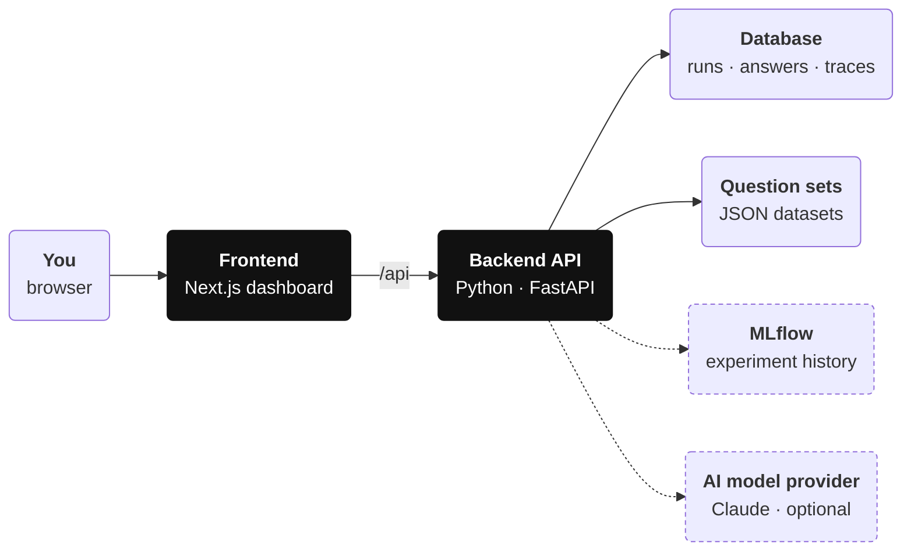

*Figure 1. The big picture. Everything in solid boxes runs on your own machine or server; dashed boxes are optional services.*

### When you run an evaluation

Before the first question, RAGLens splits every document into small passages and builds a search index for them. This happens once per setup and is reused afterwards. Then each question goes through the same steps:

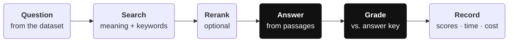

*Figure 2. Evaluating one question. The same steps run for every question in the set.*

- **Search:** find the passages most likely to contain the answer, by meaning (so "remove by mistake" finds "deleted objects") and by exact words (so a code like "ERR-4090" is found precisely).
- **Rerank:** optionally, take a closer second look at the best candidates and reorder them.
- **Answer:** an AI model (or a free offline stand-in) writes an answer using only those passages.
- **Grade:** check that the right documents were found, and that the answer is supported by the passages, addresses the question and matches the answer key.
- **Record:** store every score, the time each step took, the tokens used and the cost.

### How a change gets approved

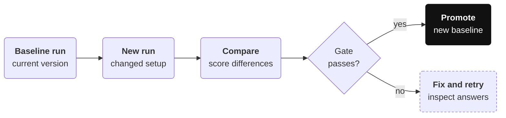

*Figure 3. The regression gate. A new version is promoted only if no score dropped by more than the allowed amount.*

The same gate runs automatically in CI, so a code change that makes answers worse fails the build just like a broken unit test.

## 4. Key ideas in plain words

| Term | Plain-language meaning |
|---|---|
| **RAG** | Retrieval-augmented generation: find the right passages first, then let an AI write an answer from them. |
| **Chunk / passage** | A small piece of a document (a paragraph or two) that can be searched and quoted. |
| **Embedding** | A list of numbers that represents what a passage is about; similar passages get similar numbers. |
| **Keyword search (BM25)** | Classic search that rewards rare words appearing in a passage. Great for names, codes and numbers. |
| **Hybrid search** | Running meaning search and keyword search together and merging their results. |
| **Reranker** | A slower, more careful second pass that reorders the best search results. |
| **Evaluation dataset** | A set of documents plus questions whose correct answers, and source documents, are known. |
| **Retrieval scores** | How well search found the right documents and ranked them near the top. |
| **Faithfulness** | Whether every statement in the answer is backed by the passages that were found. |
| **Quality Index** | One score out of 100 that combines the most important retrieval and answer scores. |
| **Baseline** | The version you currently trust; new versions are compared against it. |
| **Regression** | A change that makes results worse than the baseline. |
| **Trace** | A timeline of one question's journey, showing how long each step took. |
| **Latency (p95)** | How long a question takes; "p95" means 95% of questions were at least this fast. |
| **Tokens** | The units AI models read and write; providers charge per token. |
| **Judge** | The method that grades answers: a fast word-overlap check, or an AI model acting as grader. |
| **LLM** | Large language model: the AI that writes answers (Claude, in RAGLens). |

# Part 2 · Technical design

Architecture, RAG pipeline, evaluation, data, interfaces and operations, as implemented.

## 5. Goals and non-goals

### Goals

- Measure **retrieval quality** and **answer quality** against labelled data, per question and per run.
- Compare **chunking strategies, embedding models, retrieval methods, reranking and generators** on the same data.
- **Block regressions** with a single command, from the UI, the API or CI.
- Record **latency, failures, token usage and cost** for every query.
- Make every query **traceable** from the dashboard down to stage timings.
- Run fully **offline with zero configuration** (no API key, SQLite) and produce **deterministic** metrics suitable for CI.
- Use **Claude** for generation, reranking and judging when an API key is configured.

### Non-goals (for this version)

- Serving a production RAG application to end users. RAGLens evaluates pipelines; it is not the application.
- Authentication, multi-tenancy and role-based access control.
- Distributed job execution (runs execute inside the API process; see §21).
- A dataset authoring UI (datasets are JSON files or API uploads).
- State-of-the-art retrieval quality out of the box (the default offline models are baselines).

## 6. Requirements

### 6.1 Functional requirements

| ID | Functional requirement | Where |
|---|---|---|
| F1 | Load and validate evaluation datasets; register new ones. | `evaluation/dataset.py`, `POST /datasets` |
| F2 | Configure chunking, embedding, retrieval method, top-k, fusion, reranking and generator per run. | `rag/pipeline.PipelineConfig` |
| F3 | Execute a run asynchronously and report progress. | `POST /evaluations`, `experiments/runner.py` |
| F4 | Compute retrieval metrics: context precision, context recall, P@K, R@K, MRR, nDCG@K, hit rate. | `evaluation/metrics.py` |
| F5 | Compute answer metrics (faithfulness, relevancy, correctness) by heuristic or LLM judge. | `evaluation/evaluator.py`, `judge.py` |
| F6 | Record latency, failures, tokens and estimated cost per query and per run. | `runner.summarize_operations` |
| F7 | Persist runs, per-question results and traces. | `database/models.py` |
| F8 | Log runs to MLflow when configured. | `experiments/tracking.py` |
| F9 | Compare 2-8 runs with deltas against a baseline. | `POST /experiments/compare` |
| F10 | Pass/fail regression check of a candidate against a baseline. | `POST /experiments/regression-check` |
| F11 | Generate optimization recommendations from metrics. | `GET /evaluations/{id}/insights` |
| F12 | Run and trace a single ad-hoc question. | `POST /query` |
| F13 | Expose operational metrics as JSON and Prometheus text. | `/monitoring/summary`, `/metrics` |
| F14 | Dashboard UI for all of the above. | `frontend/` |

### 6.2 Quality attributes

| Quality | Target and approach |
|---|---|
| **Usability** | Works with zero configuration: offline defaults, SQLite, auto-seeded example runs. |
| **Reproducibility** | Same config and dataset give the same metrics offline: hashing embedders, extractive generator, heuristic judge, no randomness. |
| **Performance** | A 26-question local run finishes in seconds: index caching, bounded concurrency, numpy search (p95 ≈ 15-25 ms/query). |
| **Reliability** | One failing question never fails a run; tracking failures never fail a run; interrupted runs are recovered on restart. |
| **Responsiveness** | CPU-bound indexing and search run in worker threads, so the API stays responsive during runs. |
| **Portability** | Pure Python + numpy core; SQLite locally, PostgreSQL via Docker Compose; Windows, macOS, Linux. |
| **Observability** | Every query traced and persisted; optional OTLP export; Prometheus counters. |
| **Security** | Secrets only in environment; validated inputs; dataset-name allowlist (see §16). |

## 7. Architecture

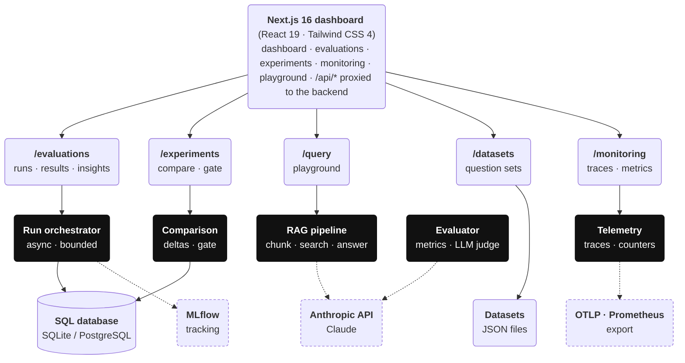

*Figure 4. Layered architecture: the Next.js client, FastAPI routes, services (black) and data stores. Solid arrows are always used; dashed ones only when the optional service is configured.*

### 7.1 Containers

| Container | Technology | Responsibility |
|---|---|---|
| **Frontend** | Next.js 16 (App Router), React 19, Tailwind 4, SWR | UI, client-side data fetching, `/api/*` reverse proxy to the backend |
| **Backend API** | FastAPI, Pydantic v2, SQLAlchemy 2 async, numpy | REST API, run orchestration, RAG pipeline, metrics, tracing |
| **Database** | SQLite (aiosqlite) or PostgreSQL (asyncpg) | Runs, sample results, traces |
| **Dataset store** | JSON files in `backend/evaluation/` | Evaluation corpora and labels |
| **MLflow** *(optional)* | MLflow server or SQLite store | Experiment tracking |
| **Anthropic API** *(optional)* | Claude via the official Python SDK | Generation, listwise reranking, LLM-as-judge |
| **OTLP collector** *(optional)* | Any OpenTelemetry backend | Trace export |

### 7.2 Backend packages

Each node is a package with its main modules; arrows point to the packages it uses. Every package also uses `core/` (settings, text utilities, logging); those arrows are omitted.

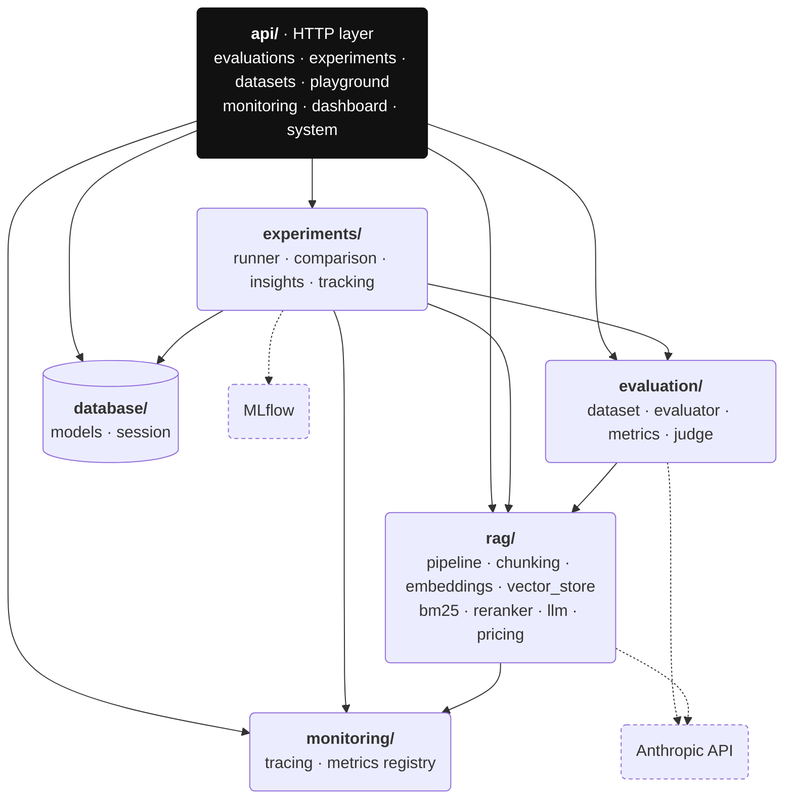

*Figure 5. Backend package dependencies. The API creates a run; the runner drives the pipeline, scores with the evaluator, records telemetry, persists results and logs to MLflow.*

### 7.3 Layering rules

- `api/` depends on every other package. No other package imports `api/`.
- `rag/` does not import `evaluation/` or `experiments/`. The pipeline knows nothing about metrics.
- `evaluation/` depends on `rag/` only for types (`QueryResult`, `NO_ANSWER`) and the similarity embedder.
- `experiments/` composes `rag/`, `evaluation/`, `monitoring/` and `database/`.
- `core/` (settings, text utilities, logging) has no internal dependencies.

### 7.4 Application lifecycle

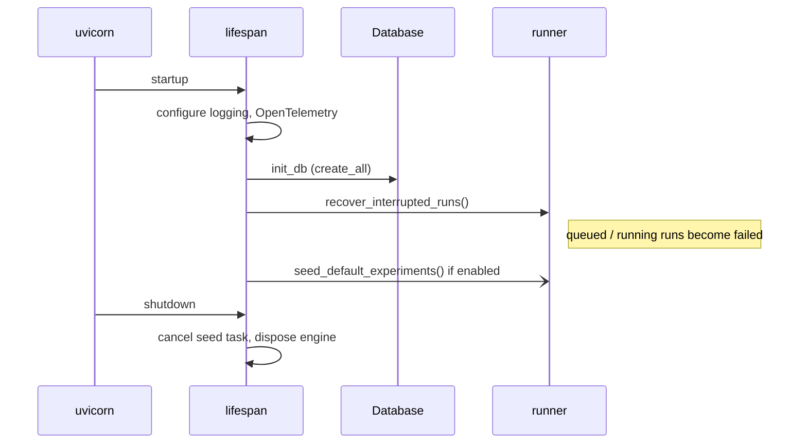

*Figure 6. Startup and shutdown.*

Middleware order is CORS, then an HTTP observation middleware. The observation middleware records method, **route template** (for example `/evaluations/{run_id}`, which keeps Prometheus label cardinality bounded), status and latency. Unhandled exceptions are recorded as status 500.

### 7.5 Module responsibilities

| Module | Key types / functions | Responsibility |
|---|---|---|
| `core/text.py` | `tokenize`, `stem`, `content_terms`, `split_sentences` | Shared text normalisation |
| `rag/chunking.py` | `Document`, `Chunk`, `chunk_documents` | Fixed / sentence / recursive chunking |
| `rag/embeddings.py` | `EmbeddingModel`, hashing embedders, `get_embedder` | Text → L2-normalised vectors |
| `rag/vector_store.py` | `InMemoryVectorStore`, `QdrantVectorStore` | Cosine top-k search |
| `rag/bm25.py` | `BM25Index` | Okapi BM25 keyword search |
| `rag/reranker.py` | `LexicalReranker`, `LLMReranker` | Second-stage reranking |
| `rag/llm.py` | `LocalExtractiveGenerator`, `AnthropicGenerator` | Answer generation |
| `rag/pipeline.py` | `PipelineConfig`, `RAGPipeline`, `build_index` | Pipeline assembly and execution |
| `rag/pricing.py` | `MODEL_PRICING`, `estimate_cost` | Token → USD |
| `evaluation/dataset.py` | `EvaluationDataset`, `load_dataset`, `save_dataset` | Dataset schema, validation, storage |
| `evaluation/metrics.py` | metric functions, `QUALITY_WEIGHTS`, `quality_index` | Pure metric math |
| `evaluation/evaluator.py` | `evaluate_sample`, `aggregate_metrics` | Score one result; aggregate a run |
| `evaluation/judge.py` | `judge_answer`, `JudgeVerdict` | Claude LLM-as-judge |
| `experiments/runner.py` | `create_run`, `launch_run`, `execute_run` | Orchestration and persistence |
| `experiments/comparison.py` | `compare_runs`, `check_regression` | Comparison and gating |
| `experiments/insights.py` | `recommend` | Rule-based recommendations |
| `experiments/tracking.py` | `log_run` | MLflow logging |
| `monitoring/tracing.py` | `Trace`, `Span`, `setup_opentelemetry` | Span recording and OTel bridge |
| `monitoring/metrics.py` | `MetricsRegistry` | In-process counters, Prometheus text |

### 7.6 Extension points

Each pluggable stage is a `typing.Protocol` plus a factory, so adding a variant touches one module and the factory.

| Stage | Protocol | Factory | To add a variant |
|---|---|---|---|
| **Embeddings** | `EmbeddingModel` | `get_embedder(name)` | Implement; register the name in `get_embedder` and `list_embedding_models` |
| **Vector store** | `VectorStore` | `create_vector_store(…)` | Implement; add a `VECTOR_STORE` value |
| **Reranker** | `Reranker` | `get_reranker(name)` | Implement; extend the `PipelineConfig.reranker` literal |
| **Generator** | `Generator` | `get_generator(provider, model)` | Implement; extend `llm_provider` and pricing |
| **Metric** | pure function | `evaluate_sample` | Add the function, a `MetricDefinition`, optionally a QI weight |

## 8. Technology choices

| Area | Choice | Why |
|---|---|---|
| **API** | FastAPI + Pydantic v2 | Async I/O, typed validation, automatic OpenAPI docs. |
| **Persistence** | SQLAlchemy 2 (async); SQLite locally, PostgreSQL in Docker | Zero setup for development, a production database for deployment, one code path. |
| **Vector search** | Exact numpy cosine search; Qdrant optional | No services needed for evaluation-sized corpora; Qdrant for larger ones. |
| **Keyword search** | Own Okapi BM25 | Small, transparent, and keeps identifiers such as `ERR-4090` intact. |
| **Embeddings** | Feature hashing; sentence-transformers optional | Deterministic and dependency-free; neural models when installed. |
| **LLM** | Claude (`claude-opus-5-5`) via the official `anthropic` SDK | Structured outputs for judging and reranking, server-side refusal fallbacks, exact token usage. |
| **Evaluation** | Own metric suite following Ragas definitions | Reproducible, offline, no heavy dependency or API churn. |
| **Tracking** | MLflow | The standard experiment-tracking UI and API. |
| **Observability** | Persisted spans, OpenTelemetry (OTLP), Prometheus text | Works offline, exports to any tracing backend, scrapeable metrics. |
| **Frontend** | Next.js 16, React 19, Tailwind CSS 4, SWR, hand-written SVG charts | Static shells with client-side polling; full control over the chart style. |
| **Testing / CI** | pytest, ESLint, TypeScript, GitHub Actions | Fast offline suite plus a quality gate on every push. |
| **Deployment** | Docker + Docker Compose | One command for PostgreSQL, MLflow, API and dashboard. |

## 9. RAG pipeline design

### 9.1 Pipeline configuration

`PipelineConfig` (Pydantic) fully defines a variant and is stored verbatim with each run.

| Field | Type / range | Default |
|---|---|---|
| `retrieval_method` | `vector` \| `bm25` \| `hybrid` | `vector` |
| `embedding_model` | string | `local-hash-ngrams` |
| `chunking_strategy` | `recursive` \| `sentence` \| `fixed` | `recursive` |
| `chunk_size` | 100-4000 chars | 500 |
| `chunk_overlap` | 0-1000 chars, `< chunk_size` | 50 |
| `top_k` | 1-20 | 5 |
| `fusion` | `rrf` \| `weighted` | `rrf` |
| `hybrid_alpha` | 0-1 (vector weight, weighted fusion only) | 0.5 |
| `reranking_enabled` | bool | false |
| `reranker` | `lexical` \| `llm` | `lexical` |
| `rerank_candidates` | 2-100 | 20 |
| `llm_provider` | `local` \| `anthropic` \| null → `LLM_PROVIDER` | null |
| `llm_model` | string \| null → `ANTHROPIC_MODEL` | null |

A model validator rejects `chunk_overlap >= chunk_size` and resolves the default provider.

### 9.2 Query flow

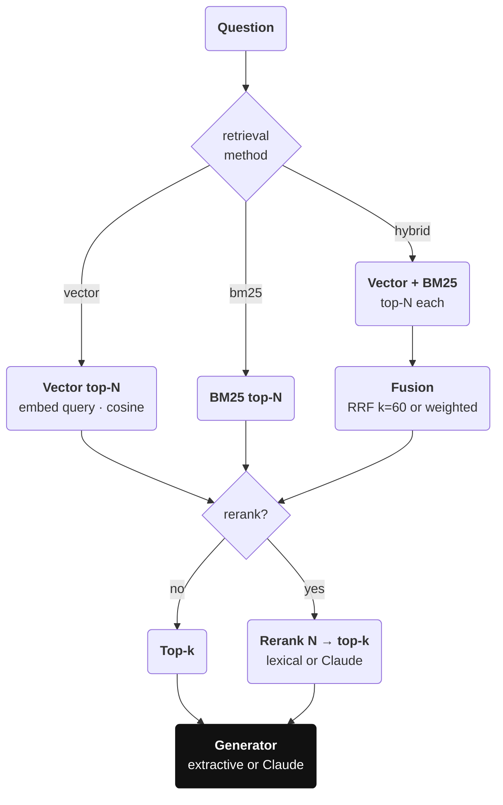

*Figure 7. Retrieval and generation for one question.*

`N` (the candidate pool) is `max(rerank_candidates, top_k)` when reranking is enabled, otherwise `top_k`. In hybrid mode each retriever returns `N` results before fusion, and the fused list is truncated to `N`. Each stage runs inside a trace span (`retrieval`, `rerank`, `generation`). First-stage retrieval is CPU-bound and runs in a worker thread.

### 9.3 Text processing

- **Tokenisation:** lowercase; the regex `[a-z0-9]+(?:[-_.][a-z0-9]+)*` keeps identifiers such as `err-4012`, `eu-central-1` and `v2.4` intact, which matters for keyword retrieval.
- **Stopwords:** a fixed English list (~150 words).
- **Stemming:** a small suffix stripper (`ations`, `ation`, `ings`, `ing`, `edly`, `ies`→`y`, `ied`→`y`, `ed`, `es`, `ly`, `s`) with minimum-length guards; tokens of length ≤ 4 and tokens containing digits are not stemmed.
- **Sentence splitting:** on `[.!?]` followed by whitespace and an uppercase letter, digit, quote or bracket.
- **Token estimation:** `round(len(text) / 4)` for local runs; Claude runs use exact API usage.

### 9.4 Chunking

Every chunk gets the id `{doc_id}::{position}` and keeps `doc_id` and `title`, which is how retrieval results are scored against relevance labels.

| Strategy | Algorithm |
|---|---|
| **fixed** | Word-boundary windows of ≤ `chunk_size` characters; trailing words totalling ≤ `chunk_overlap` characters carry into the next window. |
| **sentence** | Packs whole sentences up to `chunk_size`; overlap repeats the previous chunk's last sentence if it is ≤ 2 × `chunk_overlap` characters. |
| **recursive** | Splits on blank lines (paragraphs) and merges them into a buffer up to `chunk_size`; over-long paragraphs fall back to sentence packing. |

### 9.5 Embeddings

Two dependency-free **feature-hashing** embedders ship by default. They are deterministic and fast but lexical in nature: they are baselines, not substitutes for neural models.

| Model | Dim | Features | Weighting |
|---|---|---|---|
| **local-hash-words** | 2048 | Stemmed content-term unigrams (1.0) + adjacent bigrams (0.5) | `1 + ln(count)` |
| **local-hash-ngrams** | 4096 | Per non-stopword token: `w:token` (1.0) and character 3/4/5-grams of `<token>` (1/n) | `1 + ln(1 + count)` |
| **sentence-transformers/…** | model | Neural sentence embeddings (optional package) | normalised |

Hashing: `crc32(feature) mod dim` picks the bucket; the hash's high bit picks a ±1 sign, which reduces collision bias. Vectors are L2-normalised, so the dot product equals cosine similarity. Chunks are embedded as `"{title}. {text}"`.

### 9.6 Indexing and caching

`build_index(documents, config)` produces an `IndexedCorpus` (chunks, vector store, BM25 index, chunks-per-document counts). Indexes are cached in a process-wide LRU of capacity **16**, guarded by a `threading.Lock` and keyed by:

```
sha256(doc ids + texts) | embedding_model | chunking_strategy | chunk_size | chunk_overlap | VECTOR_STORE
```

Configurations that differ only in retrieval method, top-k, fusion, reranking or generator reuse the same index. This is the common case in experiments.

### 9.7 Vector store

- **InMemoryVectorStore** (default): a row-stacked numpy matrix. Search computes `M · q` and uses `argpartition` plus a top-k sort: exact, O(n·d) per query.
- **QdrantVectorStore** (`VECTOR_STORE=qdrant`): an in-process `:memory:` instance or a server at `QDRANT_URL`. Each index gets its own collection with cosine distance; point ids are UUIDv5 of the chunk id.

### 9.8 BM25

Okapi BM25 over stemmed content terms of `"{title} {text}"` with `k1 = 1.5`, `b = 0.75`. Only documents with a positive score are returned.

```
idf(t)      = ln(1 + (N - df(t) + 0.5) / (df(t) + 0.5))
score(q, d) = Σ over t in q:  idf(t) · f(t,d)·(k1+1) / (f(t,d) + k1·(1 - b + b·|d|/avgdl))
```

### 9.9 Reciprocal rank fusion

Vector cosine scores and BM25 scores live on unrelated scales, so by default they are combined by **rank**, not by value:

```
fused(d) = Σ over lists  1 / (60 + rank_list(d))        # rank starts at 1; absent → no contribution
```

A chunk ranked well by both searches rises to the top, while a chunk found by only one search still competes. The alternative **weighted fusion** min-max normalises each list to [0, 1] and computes `α·vector + (1-α)·bm25`.

### 9.10 Reranking

**Lexical cross-scorer** (`lexical`, free). Each candidate is scored as:

```
idf(t)   = ln(1 + (n + 1) / (df_pool(t) + 0.5))          # df over the candidate pool
coverage = Σ idf(t) for t in q ∩ chunk  /  Σ idf(t) for t in q
phrase   = |bigrams(q) ∩ bigrams(chunk)| / |bigrams(q)|
title    = |terms(q) ∩ terms(title)| / |terms(q)|
prior    = 1 / (1 + first_stage_rank)
score    = 0.55·coverage + 0.20·phrase + 0.10·title + 0.15·prior
```

**LLM listwise reranker** (`llm`, Claude). One request per question numbers every candidate and asks for a 0-10 relevance score each, returned through structured output (`client.beta.messages.parse` with a Pydantic schema). The final score is `relevance/10 + 0.01/position` (the small positional prior breaks ties). Its tokens and cost are attributed to the sample; a refusal or an empty parse raises `LLMError`.

### 9.11 Answer generators

**Local extractive generator** (`local-extractive`, $0):

1. Split every retrieved chunk into sentences and compute sentence-level IDF `ln(1 + n/(1 + df))`.
2. Score each sentence: `(Σ idf of question terms present / Σ idf of question terms) × (1 − 0.04·chunk_rank)`.
3. If the best score is below **0.2**, abstain with *"I don't know based on the provided context."*
4. Otherwise return the best sentence, plus at most one more that adds new question terms and scores ≥ 60% of the best.

Answers are therefore fully grounded in the context (faithfulness is 1.0 by construction; see §10.6).

**Claude generator** (`anthropic`):

| Aspect | Design |
|---|---|
| **SDK** | Official `anthropic` Python SDK, `AsyncAnthropic`, `timeout=120s`, `max_retries=3` (retries 408/409/429/5xx with backoff). |
| **Model** | `ANTHROPIC_MODEL` (default `claude-opus-5-5`) or the per-run `llm_model`. |
| **Request** | `client.beta.messages.create` with the grounding system prompt, user content `<context>[i] (title) text…</context> Question: …`, `max_tokens=8000`, `output_config={"effort": "low"}`. |
| **Safety fallback** | `betas=["server-side-fallback-2026-07-01"]`, `fallbacks="default"`: on a policy decline the API re-runs the request on Anthropic's recommended fallback model. |
| **Refusal** | `stop_reason == "refusal"` → `LLMError`; the sample fails and the run continues. |
| **Errors** | Typed SDK exceptions (authentication, rate limit, bad request, status, connection) map to readable `LLMError` messages. |
| **Usage** | Exact `usage.input_tokens/output_tokens`; `response.model` (the model that served the request) is used for pricing. |

### Grounding prompt

```
You answer questions for a retrieval-augmented generation system. Use only the numbered
context passages supplied with the question. If the passages do not contain the answer,
reply exactly: "I don't know based on the provided context." Answer in one to three
sentences, state specific values (numbers, names, limits) exactly as written in the
passages, and do not add outside knowledge.
```

### 9.12 Cost model

`estimate_cost(model, in, out) = (in · price_in + out · price_out) / 1e6`, with prices in USD per million tokens (§17.2). A sample's cost is generation cost plus LLM-reranker cost; judge cost is accounted separately as *evaluation cost*. Local runs cost $0, so RAGLens also reports a **projected cost**: the run's token usage priced at `COST_REFERENCE_MODEL` (default `claude-opus-5-5`).

## 10. Evaluation design

### 10.1 Relevance model

Relevance is labelled at **document** level (`relevant_doc_ids`): a retrieved chunk is relevant if and only if its `doc_id` is in the sample's relevant set. Labels therefore survive any change of chunking strategy, which keeps dataset authoring cheap. For each sample the evaluator builds the ranked boolean list `rel[1..K]` and the retrieved document list `docs[1..K]`.

### 10.2 Retrieval metrics

All metrics are in [0, 1]. `R` is the relevant document set and `K = top_k`.

| Metric | Formula |
|---|---|
| **Precision@K** | `Σ rel_i / K` over the top K |
| **Recall@K** | `|set(docs[1..K]) ∩ R| / |R|` (distinct documents) |
| **MRR** | `1 / min{i : rel_i}` (0 if none) |
| **Hit rate** | 1 if any `rel_i`, else 0 |
| **nDCG@K** | `DCG / IDCG`, `DCG = Σ rel_i / log2(i+1)`; IDCG assumes `min(K, relevant chunks in corpus)` hits first |
| **Context precision** | Average precision `Σ (P@i · rel_i) / hits` (Ragas definition: rewards early relevant chunks) |

### 10.3 Answer metrics: heuristic judge (default)

Deterministic, free and reproducible; used in CI. A statement is **supported** if ≥ 50% of its content terms occur in at least one retrieved chunk.

| Metric | Definition |
|---|---|
| **Faithfulness** | Share of answer sentences supported by the retrieved context; an abstention scores 1.0 (it claims nothing). |
| **Context recall** | Share of reference-answer sentences supported by the retrieved context. |
| **Answer relevancy** | `min(1, 0.6·coverage + 0.4·min(1, 2·cos(q, a)))`, coverage = share of question terms in the answer; abstention → 0. |
| **Answer correctness** | `min(1, 0.75·F1_token(a, ref) + 0.25·cos(a, ref))` (the Ragas weighting); abstention → 0. |

Cosine similarity uses the `local-hash-ngrams` embedder regardless of the run's embedding model, so answer scores are comparable across runs.

### 10.4 Answer metrics: LLM judge

One Claude request per sample (`ANTHROPIC_JUDGE_MODEL`, effort `low`, `max_tokens=4000`, refusal fallbacks enabled) returns a **validated structured output**:

```python
class JudgeVerdict(BaseModel):
    answer_claims_total: int              # >= 0
    answer_claims_supported: int          # >= 0
    reference_statements_total: int       # >= 0
    reference_statements_in_context: int  # >= 0
    answer_relevancy: int                 # 0..10
    answer_correctness: int               # 0..10
    rationale: str
```

Safeguards:

1. The schema is enforced with `client.beta.messages.parse(output_format=JudgeVerdict)`; the judge never returns free-form numbers that need text parsing.
2. The judge returns **counts**; ratios are computed in code and clamped to [0, 1]. Empty denominators have defined values (faithfulness 1.0 with no claims, context recall 0.0).
3. A refusal, an empty parse or an API error fails **that sample** with the message. It never silently falls back to a default score.
4. Judge tokens and cost are recorded separately (`evaluation_usd`).
5. The judge mode is stored per run; compare answer metrics only between runs with the same judge.

### 10.5 Aggregation and Quality Index

Run metrics are the mean over completed samples (failed samples are excluded and counted in `failure_rate`), rounded to 4 decimals. `GET /evaluations/{id}/metrics` returns the same aggregation per dataset category.

```
QI = 100 × Σ w_m · metric_m / Σ w_m           (over metrics that are present)

w = { context_precision: 0.15, context_recall: 0.20, mrr: 0.15,
      faithfulness: 0.20, answer_relevancy: 0.10, answer_correctness: 0.20 }
```

The weights split evenly between retrieval (0.50) and answer quality (0.50).

### 10.6 Metric validity notes

- With the extractive generator, faithfulness is 1.0 by construction and correctness reflects sentence extraction rather than synthesis. Generative quality needs `llm_provider=anthropic`, ideally with `judge=llm`.
- The heuristic judge under-rewards correct paraphrases. It is designed for **relative** comparison of retrieval configurations, not absolute answer quality.
- Hashing embedders make "vector" retrieval partly lexical, so vector-vs-BM25 differences are smaller than with neural embeddings.

### 10.7 Measured results

The bundled benchmark has 22 documents (12 answer-bearing pages plus 10 distractors, such as a changelog with superseded values and an SDK page that conflicts with the CLI page) and 26 questions: factual (12), keyword (5), paraphrase (5), reasoning (2), multi-hop (2). Offline stack: `local-hash-ngrams`, recursive 500/50 chunks, top-k 5, heuristic judge. Reproduce with `python -m scripts.run_evaluation --compare-defaults`.

| Run | QI | Ctx precision | Ctx recall | Recall@K | MRR | nDCG@K | Correctness |
|---|---|---|---|---|---|---|---|
| **A · vector (baseline)** | 82.16 | 0.876 | 0.962 | 0.962 | 0.904 | 0.807 | 0.492 |
| **B · hybrid** | 82.82 | 0.909 | 0.962 | 0.962 | 0.942 | 0.837 | 0.471 |
| **C · hybrid + rerank** | 82.48 | 0.899 | 0.962 | 0.962 | 0.942 | 0.832 | 0.459 |
| **D · + sentence-300 chunks** | 80.84 | 0.855 | 0.923 | 0.962 | 0.923 | 0.793 | 0.472 |

Hybrid search beats vector search on ranking (MRR +0.038) because BM25 recovers exact identifiers; the lexical reranker did not help on this corpus; smaller sentence chunks raise Precision@K but lose context recall and fail the regression gate.

## 11. Experiment management

### 11.1 Run lifecycle

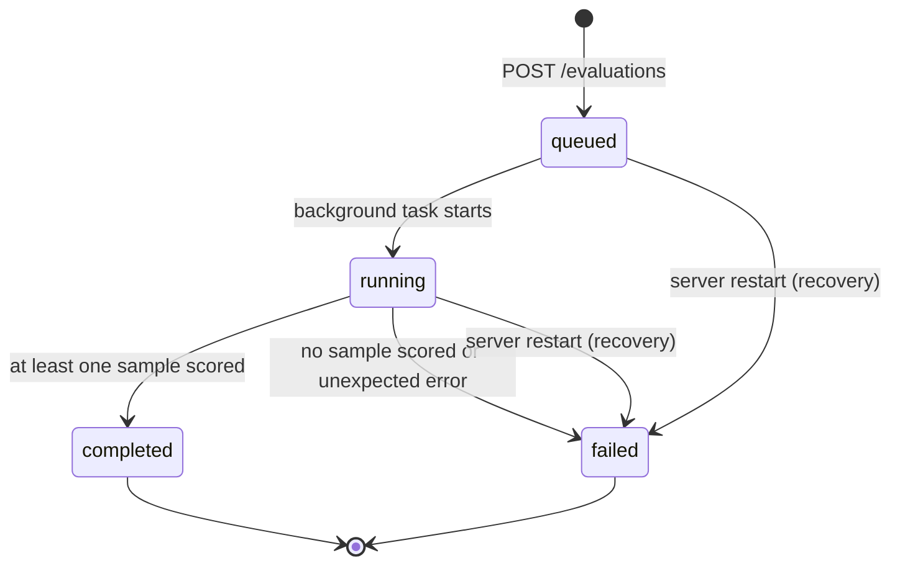

*Figure 8. Run states.*

### 11.2 Orchestration

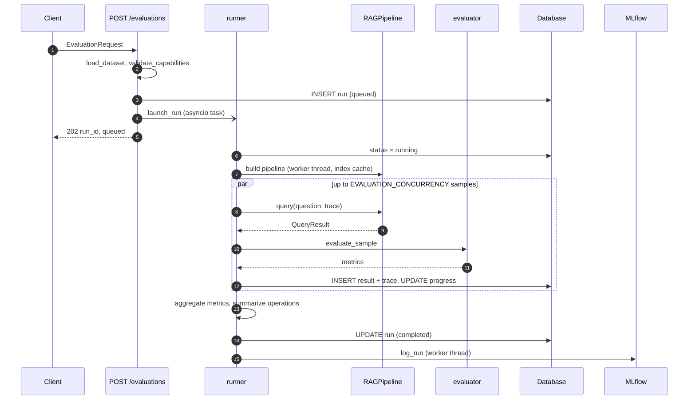

*Figure 9. Executing an evaluation run.*

**Concurrency model.** Samples run as coroutines bounded by `asyncio.Semaphore(EVALUATION_CONCURRENCY)` (default 4). All writes go through one `AsyncSession` serialised by an `asyncio.Lock`, so session use stays safe while pipeline work overlaps. Progress (`completed_samples`, `failed_samples`) is committed after every sample and drives the UI progress bar. Background tasks are held in a module-level set so they are not garbage-collected mid-flight; `active_run_count()` feeds `/health`.

| Failure | Effect |
|---|---|
| **`LLMError` / `ValueError` / `RuntimeError` in one sample** | Sample `failed` with the error; trace status `error`; the run continues. |
| **All samples failed** | Run `failed`; `error` is the first sample's error. |
| **Unexpected exception in orchestration** | Rollback; run `failed` with the exception message. |
| **MLflow error** | Logged; run stays `completed`; `mlflow_run_id` is null. |
| **Process restart mid-run** | On the next startup the run is marked `failed` ("Interrupted by a server restart"). |

### 11.3 Operational summary

`summarize_operations` produces the `operational` JSON stored on each run. Percentiles use linear interpolation between closest ranks.

| Field | Content |
|---|---|
| **latency_ms, retrieval_ms, generation_ms** | `avg`, `p50`, `p95`, `p99`, `max` over completed samples (retrieval includes rerank) |
| **failure_rate** | Failed / total samples |
| **tokens** | `input`, `output`, `total`, `avg_per_query`, `estimated` (true for the local generator) |
| **cost** | `generation_usd`, `evaluation_usd`, `total_usd`, `per_query_usd`, `projected_model`, `projected_total_usd`, `projected_per_query_usd` |
| **throughput_qps** | Samples / wall-clock seconds |

### 11.4 Comparison

`compare_runs` lines up 2-8 runs against a baseline (the requested run, otherwise the first). It returns per-run configuration, metrics, deltas and operational summary; `best_by_metric`; `winner_run_id` (best quality index); and `sample_diffs`, the 12 questions with the largest spread in per-question QI, which shows where configurations disagree.

### 11.5 Regression gate

```
allowed(metric) = max_drop[metric]            if given
                  default_max_drop            for 0-1 metrics (default 0.02)
                  default_max_drop × 100      for quality_index
passed          = candidate − baseline ≥ −allowed

latency check   = increase% ≤ max_latency_increase_pct (default 50)  OR  Δp95 < 10 ms
```

The 10 ms floor stops noise on very fast local runs from failing the gate. The response lists `passed`, the failing metrics and every check. The gate is exposed via the API, the UI and `scripts/regression_check.py`, which exits 1 on failure.

### 11.6 Recommendations

| Condition | Recommendation | Impact |
|---|---|---|
| **Recall@K < 0.85, method = vector** | Switch to hybrid retrieval | high |
| **Recall@K < 0.85, otherwise** | Widen the retrieval window (top-k / chunk size) | high |
| **MRR < 0.8 and no reranking** | Enable reranking | high |
| **Context precision < 0.7** | Reduce context noise | medium |
| **Faithfulness < 0.85** | Tighten answer grounding | high |
| **Correctness < 0.6** | Evaluate with an LLM generator / improve synthesis | medium |
| **Answer relevancy < 0.6** | Answer the question directly | low |
| **Failure rate > 0** | Investigate failed queries | high |
| **p95 latency > 3 s** | Reduce tail latency | medium |
| **None of the above** | Promote this configuration | low |

### 11.7 MLflow tracking

When `MLFLOW_TRACKING_URI` is set and `mlflow` is importable, each completed run is logged in a worker thread: experiment `MLFLOW_EXPERIMENT_NAME`; tags `raglens.run_id`, `dataset` and `tag.<key>`; every `PipelineConfig` field as a parameter; all numeric metrics plus flattened operational values (`ops.latency_ms.p95`, `ops.cost.total_usd`, …); and a `raglens_run.json` artifact. Tracking errors are logged and never fail a run.

### 11.8 Seeding

On startup with an empty database (and `AUTO_SEED_EXPERIMENTS=true`), four example runs execute sequentially with the local stack: **A** vector (marked baseline), **B** hybrid, **C** hybrid + lexical reranking, **D** hybrid + reranking with 300-character sentence chunks.

## 12. Observability

### 12.1 Tracing

A `Trace` is created per evaluated sample and per playground query. `Trace.span(name, **attrs)` is a context manager that records `start_ms` (offset from trace start), `duration_ms`, `status`/`error` (the exception is re-raised) and attributes such as `method`, `k`, `hits`, `reranker`, `model`, `input_tokens` and `output_tokens`. Spans are persisted in the `traces` table and shown in the UI as a waterfall.

With `OTEL_ENABLED=true` and `opentelemetry-sdk` installed, a `TracerProvider` (resource `service.name = OTEL_SERVICE_NAME`) with a `BatchSpanProcessor` exports to OTLP/HTTP at `OTEL_EXPORTER_OTLP_ENDPOINT`, or to the console. Each span is mirrored as `{trace}.{span}` with `raglens.`-prefixed attributes and a `raglens.trace_id` link. Because export is OTLP, Jaeger, Grafana Tempo and Langfuse work without code changes.

### 12.2 Metrics registry

A thread-safe in-process registry keeps HTTP counters by `(method, route template, status)`, a latency histogram (buckets 5 ms to 30 s) and a sliding window of the last 2000 latencies, plus pipeline counters (queries, failures, tokens, cost). `GET /metrics` renders Prometheus text:

| Metric | Type |
|---|---|
| **raglens_http_requests_total{method,route,status}** | counter |
| **raglens_http_request_duration_ms_bucket / _sum / _count** | histogram |
| **raglens_pipeline_queries_total, raglens_pipeline_failures_total** | counter |
| **raglens_llm_tokens_total{direction}** | counter |
| **raglens_llm_estimated_cost_usd_total** | counter |

Counters are per process and reset on restart; with several workers, each instance is scraped separately.

### 12.3 Monitoring aggregation and logging

`GET /monitoring/summary?window=500` aggregates the most recent traces: latency percentiles, failure rate, tokens, cost, per-stage average and p95, a latency histogram, a per-run series and run status counts, plus the live registry snapshot. Logs go to stdout (`%(asctime)s %(levelname)s %(name)s: %(message)s`, level `LOG_LEVEL`) and cover run completion, sample failures, MLflow failures and interrupted-run recovery.

## 13. Data model

### 13.1 Entity-relationship model

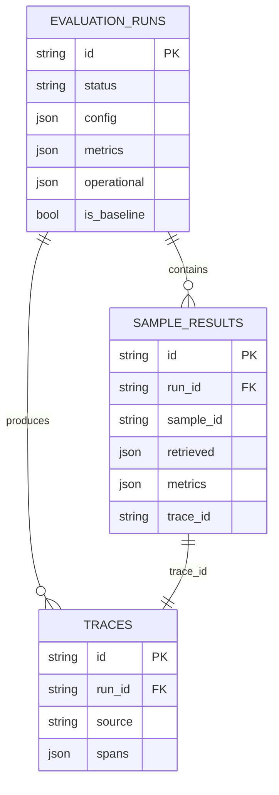

*Figure 10. Relational tables. Playground traces have `run_id = NULL`; every evaluated sample has exactly one trace.*

### 13.2 Table definitions

**evaluation_runs**: one row per evaluation run.

| Column | Type | Notes |
|---|---|---|
| **id** | string(32) PK | `uuid4().hex` |
| **name** | string(200) | User-supplied or generated from the configuration |
| **dataset** | string(64), indexed | Dataset name |
| **status** | string(16), indexed | `queued` \| `running` \| `completed` \| `failed` |
| **judge_mode** | string(16) | `heuristic` \| `llm` |
| **config** | JSON | Full `PipelineConfig` |
| **tags** | JSON | Free-form user tags |
| **metrics** | JSON | Aggregated metrics + `quality_index` |
| **operational** | JSON | Latency / tokens / cost summary (§11.3) |
| **total / completed / failed_samples** | int | Scheduled, scored and failed questions (live progress) |
| **is_baseline** | bool | At most one run is the baseline |
| **mlflow_run_id** | string(64), nullable | Set when MLflow logging succeeds |
| **error** | text, nullable | Failure reason |
| **created_at / started_at / completed_at** | datetime (UTC) | `created_at` is indexed |

**sample_results**: one row per question per run.

| Column | Type | Notes |
|---|---|---|
| **id** | string(32) PK | |
| **run_id** | FK → `evaluation_runs.id`, indexed | `ON DELETE CASCADE` |
| **sample_id / category** | string | From the dataset |
| **question / reference_answer** | text | Copied, so results stay readable if the dataset changes |
| **generated_answer** | text, nullable | Null when the sample failed before generation |
| **relevant_doc_ids** | JSON | Ground-truth labels |
| **retrieved** | JSON | Ranked chunks with scores and relevance (§13.4) |
| **metrics** | JSON | Per-question metric values |
| **judge_rationale** | text, nullable | One-sentence LLM-judge rationale |
| **latency_ms / retrieval_ms / generation_ms** | float | Timings (retrieval includes reranking) |
| **input_tokens / output_tokens / cost_usd** | int / float | Generation + reranker usage and cost |
| **status / error** | string / text | `completed` \| `failed` and reason |
| **trace_id** | string(32) | Links to `traces.id` |

**traces**: one row per traced query (evaluation or playground).

| Column | Type | Notes |
|---|---|---|
| **id** | string(32) PK | Also exported as `raglens.trace_id` to OpenTelemetry |
| **run_id** | FK, nullable, indexed | Null for playground queries |
| **sample_id** | string, nullable | |
| **source** | string(16) | `evaluation` \| `playground` |
| **question** | text | |
| **status / error** | string, indexed / text | `ok` \| `error` |
| **duration_ms** | float | End-to-end duration |
| **spans** | JSON | Span list (§13.5) |
| **attributes** | JSON | Generator model, projected model, judge tokens and cost, playground config |
| **input_tokens / output_tokens / cost_usd** | int / float | Usage and cost |
| **created_at** | datetime (UTC), indexed | |

### 13.3 Design notes

- **Indexes:** `evaluation_runs(dataset)`, `(status)`, `(created_at)`; `sample_results(run_id)`; `traces(run_id)`, `(status)`, `(created_at)`.
- **Integrity:** `ON DELETE CASCADE` from runs to results and traces. SQLite enables `PRAGMA foreign_keys=ON` and `journal_mode=WAL` per connection. `DELETE /evaluations/{id}` also deletes children explicitly, so behaviour is the same without cascade support.
- **JSON columns** hold configuration, metrics and spans. They are read whole and never queried by inner field, which keeps the schema stable as metrics evolve.
- **Timezone-aware timestamps:** a `UTCDateTime` `TypeDecorator` returns UTC-aware datetimes on every backend. SQLite drops offsets, and naive timestamps would otherwise be shown in the browser's local time.
- **Schema management:** tables are created with `metadata.create_all` at startup. Alembic migrations are **planned** (§22).

### 13.4 Retrieved-chunk record

```json
{ "rank": 1, "chunk_id": "doc-error-codes::1", "doc_id": "doc-error-codes",
  "title": "API Error Codes", "score": 0.380232, "text": "…", "relevant": true }
```

### 13.5 Span record

```json
{ "name": "retrieval", "start_ms": 0.012, "duration_ms": 2.104, "status": "ok",
  "error": null, "attributes": { "method": "hybrid", "k": 20, "hits": 20 } }
```

### 13.6 Dataset schema and validation

```json
{
  "name": "sample_dataset",
  "description": "…",
  "documents": [{ "id": "doc-pricing", "title": "Plans and Pricing", "text": "…" }],
  "samples": [{ "id": "q01", "category": "factual", "question": "…",
                "reference_answer": "…", "relevant_doc_ids": ["doc-pricing"] }]
}
```

- `name` must match `^[a-z0-9][a-z0-9_-]{1,63}$`. This is also the path-traversal guard, because the name becomes a file name.
- At least one document and one sample; non-empty text; questions of at least 3 characters.
- Document ids and sample ids are unique; every `relevant_doc_ids` entry references an existing document.
- Storage is one file per dataset at `DATASETS_DIR/<name>.json`; invalid files are skipped when listing; uploads return 409 if the name exists, unless `overwrite: true`.

## 14. API reference

JSON over HTTP; the OpenAPI schema and Swagger UI are at `/docs`. Request bodies are validated by Pydantic; long-running work is asynchronous (submit with `POST`, then poll).

| Method | Path | Purpose |
|---|---|---|
| **GET** | `/health` | Status, database reachability, active runs |
| **GET** | `/config` | Providers, models, integrations, metric definitions, pricing |
| **GET · POST** | `/datasets`, `/datasets/{name}` | List, view and register datasets |
| **POST** | `/evaluations` | Start a run (202) |
| **GET** | `/evaluations` | List runs (`status`, `dataset`, `limit` ≤ 200, `offset`) |
| **GET** | `/evaluations/{id}` | Run details and progress |
| **GET** | `/evaluations/{id}/metrics` | Aggregates, operational stats, per-category breakdown |
| **GET** | `/evaluations/{id}/results` | Per-question answers, retrieved chunks, scores |
| **GET** | `/evaluations/{id}/insights` | Recommendations |
| **POST** | `/evaluations/{id}/baseline` | Mark as regression baseline |
| **DELETE** | `/evaluations/{id}` | Delete a run (204) |
| **POST** | `/experiments/compare` | Compare 2-8 runs against a baseline |
| **POST** | `/experiments/regression-check` | Pass/fail gate for a candidate |
| **POST** | `/query` | Run one traced question (playground) |
| **GET** | `/traces`, `/traces/{id}` | Traces with spans (`run_id`, `source`, `status`, `limit` ≤ 500) |
| **GET** | `/monitoring/summary` | Latency, failures, tokens, cost, stages (`window` 10-5000) |
| **GET** | `/dashboard/overview` | Aggregated dashboard data |
| **GET** | `/metrics` | Prometheus text |

### Example: start a run

```
POST /evaluations
Content-Type: application/json

{
  "dataset": "sample_dataset",
  "retrieval_method": "hybrid",
  "embedding_model": "local-hash-ngrams",
  "top_k": 5,
  "reranking_enabled": true,
  "judge": "heuristic",
  "set_as_baseline": false
}

→ 202 Accepted
{ "run_id": "8be516cb7a09461da9941670265780fa", "status": "queued",
  "message": "Evaluation submitted successfully" }
```

`EvaluationRequest` is `PipelineConfig` plus `name`, `dataset`, `judge` (`heuristic` \| `llm`), `sample_limit`, `tags` and `set_as_baseline` (which clears the previous baseline). `RegressionCheckRequest` takes `candidate_run_id`, an optional `baseline_run_id` (default: the marked baseline), per-metric `max_drop`, `default_max_drop` (0.02) and `max_latency_increase_pct` (50).

### Error mapping

| Status | Used for |
|---|---|
| **202 / 201 / 204** | Evaluation accepted · dataset created · run deleted |
| **404** | Unknown run, dataset or trace |
| **409** | Run not completed (insights, compare, baseline) · run still in progress (delete) · dataset exists |
| **422** | Validation errors · Claude features without `ANTHROPIC_API_KEY` · no baseline marked |
| **502** | Playground query failed at the LLM provider |

`validate_capabilities` rejects any request that needs Claude (`llm_provider=anthropic`, `reranker=llm` with reranking on, or `judge=llm`) when no key is configured. The UI reads `/config` and disables those options up front; this is the server-side backstop.

## 15. Frontend design

| Area | Design |
|---|---|
| **Framework** | Next.js 16 App Router, React 19, TypeScript (strict); `cacheComponents` and `partialPrefetching` enabled. |
| **Rendering** | Pages are Client Components: a static shell is prerendered, then data is fetched in the browser. |
| **Data fetching** | SWR via `useApi<T>(path)` with `revalidateOnFocus: false` and `keepPreviousData: true`; adaptive polling. |
| **API access** | Same-origin `/api/*`, rewritten by Next.js to `BACKEND_URL` (`next.config.ts`); no CORS in the browser. |
| **Typed client** | `lib/api.ts` mirrors the backend schemas; `ApiError` flattens FastAPI `detail` messages for display. |
| **Styling** | Tailwind CSS 4 with design tokens as CSS variables mapped through `@theme inline`; dark theme. |
| **Output** | `output: "standalone"` for a minimal Node server image. |

### 15.1 Routes and polling

| Route | Page | Data sources (polling) |
|---|---|---|
| **/** | Dashboard | `/dashboard/overview` (5 s), completed runs, `/traces?limit=72` (5 s) |
| **/evaluations** | Run list | `/evaluations` (1.5 s while a run is active, else 10 s) |
| **/evaluations/new** | Evaluation form | `/config`, `/datasets` |
| **/evaluations/[id]** | Run detail | run (1 s while active), results (2 s while running, refetched on completion), metrics, insights, trace on expand |
| **/experiments** | Comparison + gate | completed runs; `POST /experiments/compare` keyed by the selection |
| **/monitoring** | Monitoring | `/monitoring/summary` (5 s), `/traces` (5 s) |
| **/playground** | Single query | `/config`, sample dataset, `POST /query` |
| **/datasets, /settings** | Browsers | `/datasets`, `/config` |

The shell polls `/health` every 10 s (sidebar status) and `/dashboard/overview` every 15 s (alert bell).

### 15.2 Rendering constraints

With `cacheComponents`, hooks that read request-time data (`useParams`, `useSearchParams`, `usePathname`) must sit inside `<Suspense>`. The sidebar and header are wrapped with same-sized fallbacks (no layout shift), as are the run-detail and experiments pages. Static routes are fully prerendered and `/evaluations/[id]` is partially prerendered. The clock reads time in an effect to avoid hydration mismatches, and no component calls `setState` inside an effect: defaults are derived during render.

### 15.3 Visualisation

All charts are hand-written SVG sized with `ResizeObserver`, so text renders at real pixel size.

| Chart | Purpose | Interaction |
|---|---|---|
| **RadarChart** | Seven 0-1 metrics per run; ≥ 0.8 target band; decorative orbit (off under reduced motion) | Focusable vertices; tooltip lists every series |
| **TrendChart / Sparkline** | Quality index and latency over runs | Crosshair + nearest-point tooltip |
| **TraceFeed** | Per-query latency "signal"; failures highlighted | Per-bar tooltip |
| **Histogram** | Latency distribution | Per-bucket tooltip |
| **TraceWaterfall** | Span offsets and durations | Error text on hover |

Run-comparison colours (`#0891b2`, `#8b5cf6`, `#d97706`, `#db2777`) were validated on the dark surface for lightness, chroma, colour-vision-deficiency separation and ≥ 3:1 contrast. Each selected run keeps its colour while the selection changes. Values in tooltips are also available in tables, every multi-series chart has a legend, the baseline is dashed as well as coloured, and status colours always come with a label or icon.

## 16. Security, performance and reliability

### 16.1 Security

| Concern | Control |
|---|---|
| **Secrets** | API keys only in environment / `backend/.env` (git-ignored); `/config` exposes availability flags, never keys. |
| **Input validation** | Every body is a Pydantic model with ranges and literals; query parameters are bounded. |
| **Path traversal** | Dataset names must match the allowlist regex before touching the file system. |
| **SQL injection** | All queries use the SQLAlchemy expression API (bound parameters). |
| **CORS** | Restricted to `CORS_ORIGINS`; the dashboard uses a same-origin proxy anyway. |
| **Containers** | Backend and frontend images run as non-root users. |
| **Prompt injection** | Documents are wrapped in a `<context>` block and the system prompt restricts answers to them. Datasets are trusted evaluation data, not adversarial input. |
| **AuthN / AuthZ** | **Not implemented.** Run locally or behind an authenticating proxy (planned, §22). |

### 16.2 Performance and scalability

| Dimension | Characteristic |
|---|---|
| **Indexing** | O(total chunk text) per unique index key; cached (LRU 16). |
| **Vector search** | Exact O(n·d) per query (d ≤ 4096); use Qdrant for large corpora. |
| **BM25** | O(n·\|q\|) per query over precomputed term frequencies. |
| **Concurrency** | `EVALUATION_CONCURRENCY` coroutines per run; CPU work in the thread pool. |
| **Measured** | 26-question local runs: p95 ≈ 15-25 ms/query, ~110-130 questions/s. |
| **Claude runs** | Dominated by API latency; concurrency bounds simultaneous requests; the SDK retries 429s. |
| **Horizontal scale** | Not for run execution (in-process tasks); reads scale with workers on PostgreSQL. |

### 16.3 Reliability

Failures are isolated per sample and partial runs keep their results. Orchestration errors are recorded on the run and never crash the API. Interrupted runs are moved to a terminal state on startup. MLflow and OpenTelemetry are best-effort and never block an evaluation. PostgreSQL connections use `pool_pre_ping`.

## 17. Configuration

### 17.1 Environment variables

Backend settings are environment variables (12-factor), read from the environment and `backend/.env`; environment variables win. Settings are cached per process, so changes need a restart.

| Variable | Default | Purpose |
|---|---|---|
| **DATABASE_URL** | `sqlite+aiosqlite:///<backend>/raglens.db` | SQLAlchemy async URL |
| **CORS_ORIGINS** | `http://localhost:3000,…` | Allowed browser origins |
| **LLM_PROVIDER** | `local` | Default generator: `local` \| `anthropic` |
| **ANTHROPIC_API_KEY** | - | Enables Claude features |
| **ANTHROPIC_MODEL** | `claude-opus-5-5` | Generation model |
| **ANTHROPIC_JUDGE_MODEL** | `claude-opus-5-5` | Judge and LLM-reranker model |
| **ANTHROPIC_EFFORT** | `low` | Generation effort level |
| **ANTHROPIC_MAX_TOKENS** | `8000` | Generation `max_tokens` |
| **ANTHROPIC_TIMEOUT_SECONDS** | `120` | SDK request timeout |
| **COST_REFERENCE_MODEL** | `claude-opus-5-5` | Pricing for projected cost |
| **VECTOR_STORE / QDRANT_URL** | `memory` / - | `memory` \| `qdrant`; Qdrant server (in-memory if unset) |
| **MLFLOW_TRACKING_URI** | - | Enables MLflow logging |
| **MLFLOW_EXPERIMENT_NAME** | `raglens-ai` | MLflow experiment |
| **OTEL_ENABLED** | `false` | Enables OpenTelemetry |
| **OTEL_SERVICE_NAME** | `raglens-api` | OTel resource name |
| **OTEL_EXPORTER_OTLP_ENDPOINT** | - | OTLP/HTTP endpoint (console if unset) |
| **DATASETS_DIR** | `<backend>/evaluation` | Dataset directory |
| **EVALUATION_CONCURRENCY** | `4` (1-64) | Parallel samples per run |
| **AUTO_SEED_EXPERIMENTS** | `true` | Seed example runs on an empty database |
| **LOG_LEVEL** | `INFO` | Python logging level |
| **BACKEND_URL** *(frontend, build time)* | `http://localhost:8000` | `/api/*` proxy target |

### 17.2 Model pricing

USD per million tokens, used by `estimate_cost`.

| Model | Input | Output |
|---|---|---|
| **claude-fable-5-1** | 10.00 | 50.00 |
| **claude-opus-5-5** | 4.00 | 20.00 |
| **claude-opus-5** | 5.00 | 25.00 |
| **claude-sonnet-5-5** | 2.00 | 10.00 |
| **claude-haiku-5-5** | 0.10 | 0.50 |
| **local-extractive** | 0.00 | 0.00 |

## 18. Deployment and operations

### Local development (no Docker)

```
# backend (Python 3.12+)
cd backend && python -m venv .venv && .venv/Scripts/activate      # source .venv/bin/activate
pip install -r requirements.txt && cp .env.example .env
uvicorn app.main:app --reload                                      # http://localhost:8000

# frontend (Node.js 20.9+)
cd frontend && npm install && npm run dev                          # http://localhost:3000
```

Defaults: SQLite at `backend/raglens.db`, offline stack, no MLflow, example runs seeded on first start.

### Production-like stack

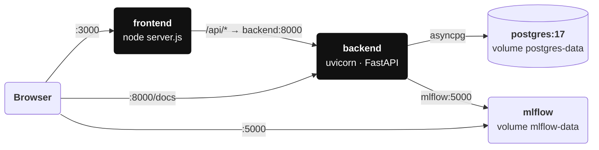

*Figure 11. Docker Compose topology (`docker compose up --build`).*

| Service | Image / build | Notes |
|---|---|---|
| **postgres** | `postgres:17-alpine` | Health-checked; the backend waits for it |
| **mlflow** | `ghcr.io/mlflow/mlflow:v3.17.0` | SQLite store and artifacts on a volume; `--allowed-hosts` for in-network access |
| **backend** | `backend/Dockerfile` (python:3.12-slim, non-root) | `HEALTHCHECK` on `/health`; `DATABASE_URL` → Postgres; optional `backend/.env` |
| **frontend** | `frontend/Dockerfile` (multi-stage node:24-alpine, standalone, non-root) | `BACKEND_URL` build arg = `http://backend:8000` |

### CI pipeline

| Job | Steps |
|---|---|
| **backend** | Python 3.12 → install → `pytest -v` → `python -m scripts.run_evaluation --compare-defaults --min-quality 78` |
| **frontend** | Node 24 → `npm ci` → `npm run lint` → `npx tsc --noEmit` → `npm run build` |

### Operational runbook

| Task | Procedure |
|---|---|
| **Health check** | `GET /health` (status, database, active runs) |
| **Scrape metrics** | Point Prometheus at `GET /metrics` on each backend instance |
| **Export traces** | `OTEL_ENABLED=true`, `OTEL_EXPORTER_OTLP_ENDPOINT=…`; install `requirements-optional.txt` |
| **Reset local data** | Stop the API, delete `backend/raglens.db` (and `mlflow.db`), restart (re-seeds) |
| **Gate a deployment** | `python -m scripts.regression_check --api <url> --config '<json>' --max-drop 0.02` (exit 1 on regression) |
| **Rotate the API key** | Update `ANTHROPIC_API_KEY` and restart |

## 19. Testing and quality

| Layer | What is covered |
|---|---|
| **Metrics (unit)** | P@K, R@K over distinct documents, MRR, hit rate, nDCG, context-precision ordering, token F1, statement support, abstentions, QI weighting, percentiles. |
| **Retrieval (unit)** | Identifier tokenisation, stemming, all chunking strategies, overlap validation, BM25 identifier ranking, embedder normalisation and determinism, RRF and weighted fusion, the pipeline per retrieval method, rerank spans. |
| **Evaluation (component)** | Dataset validation; **quality floor** (QI ≥ 78, hit rate ≥ 0.9); hybrid+rerank does not regress vector; regression gate (metric drop, threshold, latency); comparison; recommendation rules. |
| **API (integration)** | Full lifecycle (202 → completed → metrics → results → traces → insights), compare, baseline, regression check, dashboard, monitoring, Prometheus, validation errors, playground. |
| **Frontend (static)** | ESLint (Next.js core-web-vitals + TypeScript), `tsc --noEmit` and a production build, which catches prerender violations. |
| **End-to-end (manual)** | Headless Chrome: playground query, evaluation submit → completion → expanded result, regression check; zero console errors. |

41 backend tests run offline in about 3 seconds. `conftest.py` points `DATABASE_URL` at a temporary SQLite file, disables seeding, MLflow and OpenTelemetry, and blanks `ANTHROPIC_API_KEY`, so Claude paths are exercised only through their validation errors. API tests run the real ASGI app in-process via `httpx.ASGITransport`.

**Not covered by automated tests:** live Claude calls (generation, LLM reranker, judge), Qdrant, sentence-transformers, OTLP export and the Docker images. These paths are isolated behind protocols and verified manually when credentials or infrastructure are available.

# Part 3 · Trade-offs, limitations and roadmap

What was chosen and why, what is known to be missing, and what comes next.

## 20. Key design decisions

| Decision | Alternatives considered | Rationale | Consequence |
|---|---|---|---|
| **Offline default stack** | Require an LLM / embedding API | Zero setup; deterministic CI; no cost | Absolute answer scores are not meaningful; results are relative |
| **Document-level relevance labels** | Chunk- or span-level labels | Labels survive chunking changes; cheap to author | A chunk from a relevant document counts even without the answer; context recall covers the gap |
| **Own metrics, Ragas definitions** | Depend on `ragas` | Heavy dependencies, API churn, needs an LLM for most metrics | Definitions must be kept aligned manually |
| **Judge returns counts, code computes ratios** | Ask for a 0-1 score | Auditable, clamped, consistent with the heuristic definitions | One extra request per sample |
| **In-process asyncio tasks** | Celery / RQ / Arq + Redis | No extra infrastructure; enough for evaluation workloads | No horizontal scaling; runs lost on restart (recovered to `failed`) |
| **One session + write lock per run** | A session per sample | Safe `AsyncSession` use; incremental progress | Writes serialised (negligible next to query time) |
| **Index cache by content + chunking + embedder** | Rebuild per run | Experiments mostly vary retrieval, reranking or generator | Memory bounded by LRU(16) |
| **RRF default fusion** | Weighted score fusion only | Robust to score scales; no tuning | Weighted fusion kept as an option |
| **JSON columns** | Normalised metric tables | Schema-stable as metrics evolve; always read whole | No SQL filtering by metric value |
| **Next.js `/api` proxy** | Browser → API with CORS | One origin; backend location configurable | `BACKEND_URL` fixed at build time for standalone images |
| **Hand-written SVG charts** | Recharts / Chart.js / D3 | Exact visual control, small bundle | More code; accessibility handled manually |
| **Projected cost for local runs** | Report $0 only | Realistic cost signal before spending money | Clearly labelled "projected" |
| **`create_all` instead of migrations** | Alembic from day one | Fast iteration while the schema settles | Schema changes need a reset until Alembic is adopted |

## 21. Known limitations

| Limitation | Impact | Mitigation / next step |
|---|---|---|
| **Hashing embedders are lexical** | "Vector" retrieval behaves partly like keyword search | Install `sentence-transformers` and select a neural model |
| **Heuristic judge under-rewards paraphrase** | Generative answers score lower than they deserve | Use `judge=llm` for generative runs |
| **Single-process run execution** | No queueing, cancellation or retry of whole runs; restarts fail running runs | Job queue (planned) |
| **No authentication or multi-tenancy** | Not safe to expose publicly | Deploy behind an authenticating proxy; RBAC (planned) |
| **No schema migrations** | Schema changes need a database reset | Alembic (planned) |
| **Live Claude paths not in automated tests** | Provider changes could break silently | Opt-in real-model test suite (planned) |
| **Small bundled benchmark** | Configuration choices can overfit 26 questions | Bring your own datasets; per-category analysis |

### Risks

| Risk | Likelihood | Impact | Mitigation |
|---|---|---|---|
| **LLM judge bias or drift between model versions** | Medium | Misleading answer scores | Judge mode and model stored per run; compare within one judge; keep heuristic runs as a stable reference |
| **API rate limits on large Claude runs** | Medium | Failed samples, slow runs | Bounded concurrency, SDK retries, per-sample isolation, `sample_limit` |
| **Cost overrun with Claude** | Medium | Spend | Projected cost shown first; `sample_limit`; effort `low`; per-run cost reporting |

## 22. Roadmap

- **Job queue (planned):** Arq or Celery with Redis for durable, cancellable, horizontally scalable runs.
- **Alembic migrations (planned)** for schema evolution.
- **Authentication and RBAC (planned):** OIDC sign-in, per-user and per-team experiments.
- **Statistical significance (planned):** paired bootstrap over per-question scores in comparisons and the regression gate.
- **Neural rerankers and query rewriting (planned)** as new pipeline variants.
- **Scheduled benchmark runs and alerts (planned)** to Slack or email.
- **Prompt management (planned):** versioned generation prompts as part of `PipelineConfig`.
- **Dataset generation (planned)** from production traces and synthetic questions.

## Appendix A. Repository layout

```
raglens-ai/
├── backend/                         Python · FastAPI
│   ├── app/
│   │   ├── api/                     evaluations, experiments, datasets, playground,
│   │   │                            monitoring, dashboard, system routes
│   │   ├── core/                    settings, text utilities, logging
│   │   ├── rag/                     chunking, embeddings, vector store, BM25,
│   │   │                            reranker, generators, pipeline, pricing
│   │   ├── evaluation/              dataset schema, metrics, evaluator, Claude judge
│   │   ├── experiments/             runner, comparison, insights, MLflow tracking
│   │   ├── monitoring/              tracing (+OpenTelemetry), metrics (+Prometheus)
│   │   ├── database/                SQLAlchemy models and async session
│   │   └── schemas/                 Pydantic request / response models
│   ├── evaluation/                  datasets (sample_dataset.json)
│   ├── scripts/                     run_evaluation.py · regression_check.py
│   ├── tests/                       pytest suite (41 tests)
│   └── Dockerfile · requirements*.txt · pytest.ini · .env.example
├── frontend/                        Next.js 16 · React 19 · Tailwind CSS 4
│   └── src/
│       ├── app/                     dashboard, evaluations, experiments, monitoring,
│       │                            playground, datasets, settings
│       ├── components/              layout, UI primitives, SVG charts, config form
│       └── lib/                     typed API client, formatters, hooks
├── docs/                            this document, architecture overview, screenshots
├── .github/workflows/ci.yml         backend tests + quality gate, frontend checks
└── docker-compose.yml               PostgreSQL + MLflow + API + dashboard
```

## Appendix B. Glossary for engineers

| Term | Definition |
|---|---|
| **Average precision** | Mean of precision@i at each relevant rank; the basis of context precision. |
| **BM25** | Probabilistic keyword ranking with term-frequency saturation (`k1`) and length normalisation (`b`). |
| **Feature hashing** | Mapping features to vector indices with a hash instead of a vocabulary; signed to reduce collision bias. |
| **IDF** | Inverse document frequency: rarer terms weigh more. |
| **LLM-as-judge** | Using a language model to grade outputs; here constrained by a structured schema. |
| **MRR** | Mean reciprocal rank of the first relevant result. |
| **nDCG** | Normalised discounted cumulative gain: ranking quality with a log position discount. |
| **OTLP** | OpenTelemetry Protocol, the wire format for exporting traces. |
| **p95** | 95th percentile; 95% of observations are at or below it. |
| **Quality Index** | RAGLens' weighted 0-100 composite of six core metrics. |
| **RRF** | Reciprocal rank fusion: Σ 1/(k + rank) across result lists. |
| **Structured output** | An API mode that constrains model output to a JSON schema. |
