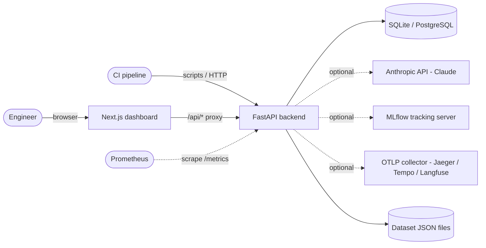
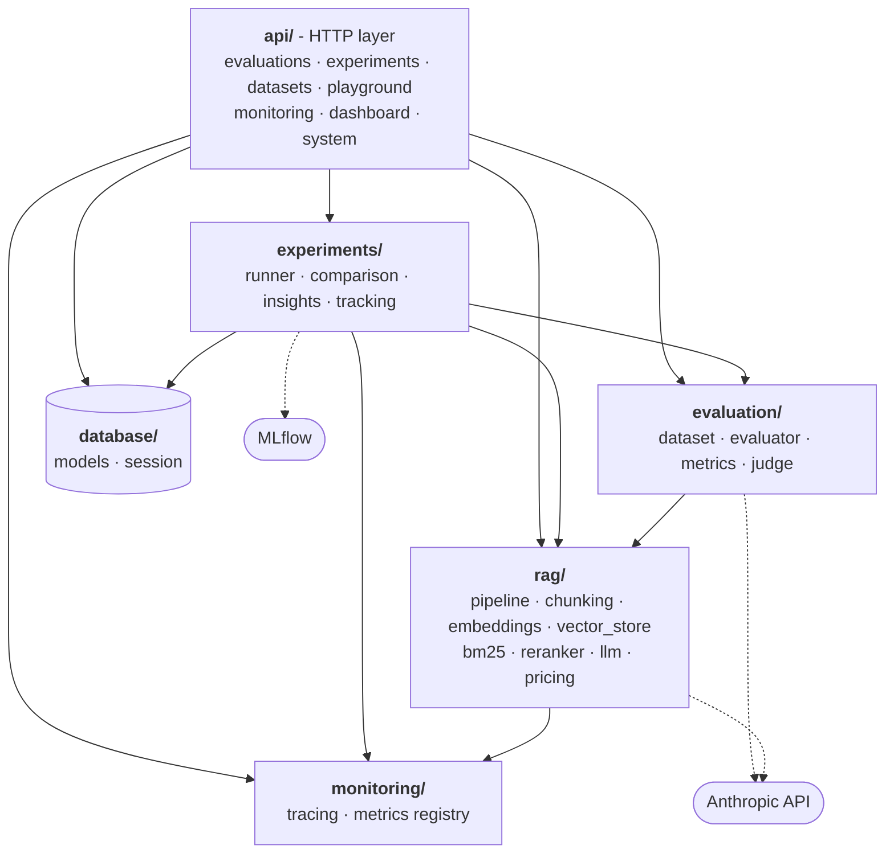
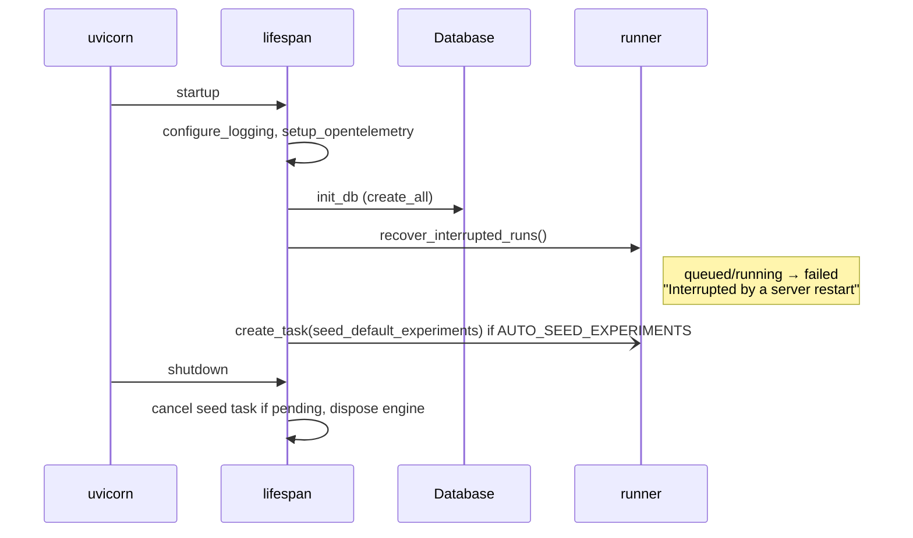
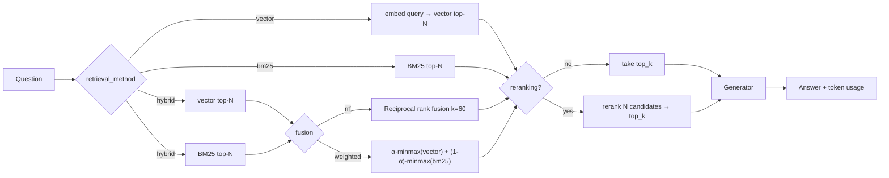
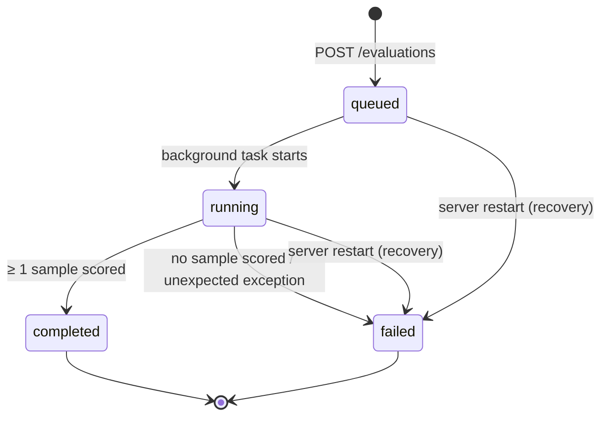
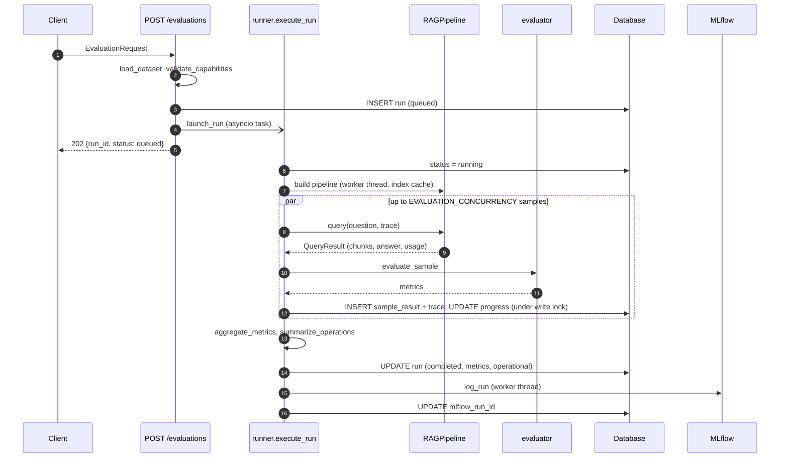
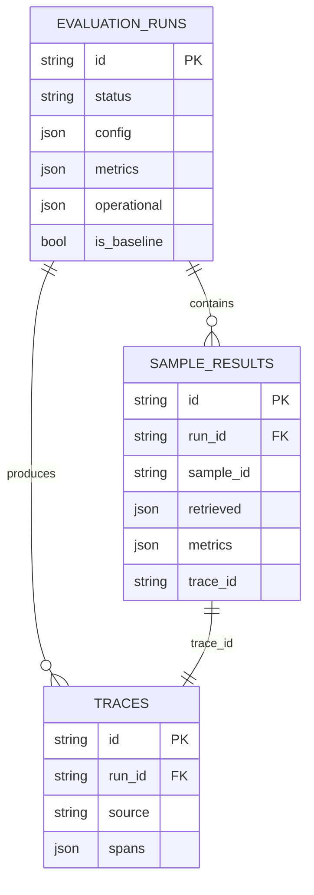
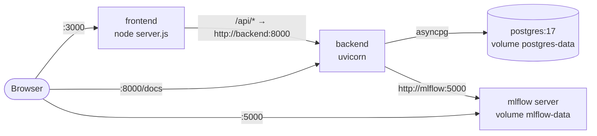

# RAGLens AI - Technical Design Document

| | |
|---|---|
| **Document** | Technical Design Document (TDD) |
| **System** | RAGLens AI - RAG evaluation & observability platform |
| **Version** | 1.0 |
| **Status** | Implemented |
| **Author** | Suriya |
| **Last updated** | 2026-10-12 |
| **Related** | [README](../README.md) · [Architecture overview](architecture.md) |

---

## Table of contents

1. [Introduction](#1-introduction)
2. [Requirements](#2-requirements)
3. [System overview](#3-system-overview)
4. [Backend design](#4-backend-design)
5. [RAG pipeline design](#5-rag-pipeline-design)
6. [Evaluation design](#6-evaluation-design)
7. [Experiment management](#7-experiment-management)
8. [Observability design](#8-observability-design)
9. [Data design](#9-data-design)
10. [API design](#10-api-design)
11. [Frontend design](#11-frontend-design)
12. [Cross-cutting concerns](#12-cross-cutting-concerns)
13. [Deployment and operations](#13-deployment-and-operations)
14. [Testing strategy](#14-testing-strategy)
15. [Design decisions and trade-offs](#15-design-decisions-and-trade-offs)
16. [Limitations, risks and future work](#16-limitations-risks-and-future-work)
17. [Appendices](#17-appendices)

---

## 1. Introduction

### 1.1 Purpose

This document describes the technical design of RAGLens AI: its architecture, components, algorithms, data model, interfaces and operational characteristics. It is written for engineers who will maintain, extend or review the system. It reflects the implemented code. Where the design deliberately simplifies (for example, in-process job execution), it says so and names the production alternative.

### 1.2 Problem statement

A RAG application's quality depends on many interacting choices: chunking, embedding model, retrieval method, top-k, reranking, the generator model and its prompt. Changing any of them can silently degrade answers, raise latency or increase cost. Teams need a repeatable way to:

1. measure retrieval and answer quality against labelled data,
2. compare configurations on the same data,
3. block regressions before they ship, and
4. observe latency, failures, tokens and cost per query.

### 1.3 Scope

**In scope**

- A configurable RAG pipeline (chunking → indexing → retrieval → optional reranking → generation).
- Evaluation of that pipeline on labelled datasets, with retrieval and answer metrics.
- Run persistence, experiment comparison, regression gating, MLflow tracking.
- Per-query tracing, operational metrics, Prometheus export, optional OpenTelemetry export.
- A web dashboard to configure, run, inspect, compare and monitor evaluations.

**Out of scope**

- Serving a production RAG application to end users (RAGLens evaluates pipelines; it is not the application).
- Authentication, multi-tenancy and RBAC.
- Distributed job execution (runs execute inside the API process).
- Dataset authoring UI (datasets are JSON files or API uploads).

### 1.4 Goals and non-goals

| Goals | Non-goals |
|---|---|
| Runs fully offline with zero configuration (no API key, SQLite) | State-of-the-art retrieval quality out of the box |
| Deterministic, reproducible default metrics suitable for CI | Replacing human evaluation |
| Pluggable providers: Claude generation, reranking and judging when a key is configured | Supporting every LLM vendor |
| Every query traceable from the UI down to span timings | Long-term trace storage or sampling strategies |
| A single command to gate a change against a baseline | A general-purpose experiment platform |

### 1.5 Definitions

| Term | Meaning |
|---|---|
| **Dataset** | A document corpus plus *samples* (questions with a reference answer and the ids of the documents that contain the answer) |
| **Chunk** | A contiguous piece of a document produced by a chunking strategy; it keeps its source `doc_id` |
| **Pipeline configuration** | All parameters defining one RAG variant (`PipelineConfig`) |
| **Run** | One evaluation of one pipeline configuration over one dataset |
| **Sample result** | The outcome of one question within a run |
| **Trace / span** | A record of one query's execution, made of timed stages |
| **Baseline** | The run that other runs are compared against and gated on |
| **Quality Index (QI)** | A weighted 0-100 composite of six core metrics |
| **Judge** | The method that scores answer metrics: `heuristic` or `llm` |
| **Projected cost** | The cost a run's token usage would incur at a reference model's prices (used for free local runs) |

---

## 2. Requirements

### 2.1 Functional requirements

| ID | Requirement | Implemented by |
|---|---|---|
| FR-1 | Load and validate evaluation datasets; register new ones | `evaluation/dataset.py`, `POST /datasets` |
| FR-2 | Configure chunking, embedding, retrieval method, top-k, fusion, reranking and generator per run | `rag/pipeline.PipelineConfig` |
| FR-3 | Execute a run asynchronously and report progress | `experiments/runner.py`, `POST /evaluations` |
| FR-4 | Compute retrieval metrics: context precision, context recall, P@K, R@K, MRR, nDCG@K, hit rate | `evaluation/metrics.py` |
| FR-5 | Compute answer metrics: faithfulness, answer relevancy, answer correctness, by heuristic or LLM judge | `evaluation/evaluator.py`, `evaluation/judge.py` |
| FR-6 | Record latency, failures, token usage and estimated cost per query and per run | `runner.summarize_operations`, `rag/pricing.py` |
| FR-7 | Persist runs, per-question results and traces | `database/models.py` |
| FR-8 | Log runs to MLflow when configured | `experiments/tracking.py` |
| FR-9 | Compare 2-8 runs with deltas against a baseline | `experiments/comparison.compare_runs` |
| FR-10 | Pass/fail regression check of a candidate against a baseline | `experiments/comparison.check_regression` |
| FR-11 | Generate optimization recommendations from metrics | `experiments/insights.py` |
| FR-12 | Run and trace a single ad-hoc question | `POST /query` |
| FR-13 | Expose operational metrics in JSON and Prometheus formats | `monitoring/metrics.py`, `GET /metrics` |
| FR-14 | Dashboard UI for all of the above | `frontend/` |

### 2.2 Non-functional requirements

| ID | Category | Requirement | How it is met |
|---|---|---|---|
| NFR-1 | Usability | Works with zero configuration | Offline defaults; SQLite; auto-seeded example runs |
| NFR-2 | Reproducibility | The same config and dataset give the same metrics offline | Deterministic hashing embedders, extractive generator and heuristic judge; no randomness |
| NFR-3 | Performance | Local runs of ~25 questions finish in seconds | Index caching, bounded concurrency, numpy search; measured p95 ≈ 15-25 ms/query |
| NFR-4 | Reliability | One failing question must not fail a run; tracking failures never fail a run | Per-sample error capture; MLflow exceptions swallowed and logged |
| NFR-5 | Responsiveness | The API stays responsive during runs | CPU-bound indexing/search run in worker threads (`asyncio.to_thread`) |
| NFR-6 | Portability | Runs on Windows, macOS, Linux and in containers | Pure-Python/numpy core; SQLite or PostgreSQL via async drivers |
| NFR-7 | Observability | Every query is traceable | Persisted spans; optional OTLP export; Prometheus counters |
| NFR-8 | Maintainability | Clear module boundaries; typed interfaces | Protocols for embedders, stores, rerankers, generators; Pydantic schemas; TypeScript client |
| NFR-9 | Security | No secrets in code or VCS; validated inputs | `.env` (git-ignored), Pydantic validation, dataset-name allowlist regex |

---

## 3. System overview

### 3.1 Context



### 3.2 Container view

| Container | Technology | Responsibility |
|---|---|---|
| **Frontend** | Next.js 16 (App Router), React 19, Tailwind 4, SWR | UI, client-side data fetching, `/api/*` reverse proxy to the backend |
| **Backend API** | FastAPI, Pydantic v2, SQLAlchemy 2 async, numpy | REST API, run orchestration, RAG pipeline, metrics, tracing |
| **Database** | SQLite (aiosqlite) or PostgreSQL (asyncpg) | Runs, sample results, traces |
| **Dataset store** | JSON files in `backend/evaluation/` | Evaluation corpora and labels |
| **MLflow** *(optional)* | MLflow server or SQLite store | Experiment tracking |
| **Anthropic API** *(optional)* | Claude via the official Python SDK | Generation, listwise reranking, LLM-as-judge |
| **OTLP collector** *(optional)* | Any OpenTelemetry backend | Trace export |

### 3.3 Backend component view

Each node is a package with its main modules. Arrows point from a package to the packages it uses. Every package also uses `core/` (settings, text utilities, logging); those arrows are omitted.



Key runtime paths: the API layer creates a run, and `experiments/runner` drives `rag/pipeline` for each question. It scores results with `evaluation/evaluator`, records spans and counters in `monitoring/`, persists everything through `database/`, and finally logs the run to MLflow.

### 3.4 Layering rules

- `api/` depends on every other package. No other package imports `api/`.
- `rag/` does not import `evaluation/` or `experiments/`. The pipeline knows nothing about metrics.
- `evaluation/` depends on `rag/` only for types (`QueryResult`, `NO_ANSWER`) and the similarity embedder.
- `experiments/` composes `rag/`, `evaluation/`, `monitoring/` and `database/`.
- `core/` (settings, text utilities, logging) has no internal dependencies.

---

## 4. Backend design

### 4.1 Application lifecycle

`app/main.py` builds the FastAPI app with a lifespan handler:



Middleware order: CORS, then an HTTP observation middleware. The observation middleware records method, **route template** (for example `/evaluations/{run_id}`, which keeps Prometheus label cardinality bounded), status and latency into the metrics registry. Unhandled exceptions are recorded as status 500.

### 4.2 Configuration

`core/config.Settings` (pydantic-settings) reads environment variables and `backend/.env`. Environment variables take precedence over the file. `get_settings()` is `lru_cache`d, so settings are immutable for the process lifetime. Derived properties:

- `cors_origin_list`: comma-split `CORS_ORIGINS`.
- `anthropic_configured`: `bool(ANTHROPIC_API_KEY)`. It gates every Claude feature.

See [Appendix A](#a-environment-variables) for the full list.

### 4.3 Module responsibilities

| Module | Key types / functions | Responsibility |
|---|---|---|
| `core/text.py` | `tokenize`, `stem`, `content_terms`, `split_sentences`, `estimate_tokens` | Shared text normalisation |
| `rag/chunking.py` | `Document`, `Chunk`, `chunk_documents` | Fixed / sentence / recursive chunking |
| `rag/embeddings.py` | `EmbeddingModel` protocol, hashing embedders, `get_embedder` | Text → L2-normalised vectors |
| `rag/vector_store.py` | `VectorStore` protocol, `InMemoryVectorStore`, `QdrantVectorStore` | Cosine top-k search |
| `rag/bm25.py` | `BM25Index` | Okapi BM25 keyword search |
| `rag/reranker.py` | `Reranker` protocol, `LexicalReranker`, `LLMReranker` | Second-stage reranking |
| `rag/llm.py` | `Generator` protocol, `LocalExtractiveGenerator`, `AnthropicGenerator` | Answer generation |
| `rag/pipeline.py` | `PipelineConfig`, `RAGPipeline`, `build_index`, fusion functions | Pipeline assembly and execution |
| `rag/pricing.py` | `MODEL_PRICING`, `estimate_cost` | Token → USD |
| `evaluation/dataset.py` | `EvaluationDataset`, `load_dataset`, `save_dataset` | Dataset schema, validation, storage |
| `evaluation/metrics.py` | Metric functions, `METRICS`, `QUALITY_WEIGHTS`, `quality_index` | Pure metric math |
| `evaluation/evaluator.py` | `evaluate_sample`, `aggregate_metrics` | Score one query result; aggregate a run |
| `evaluation/judge.py` | `judge_answer`, `JudgeVerdict` | Claude LLM-as-judge |
| `experiments/runner.py` | `create_run`, `launch_run`, `execute_run`, `summarize_operations` | Orchestration and persistence |
| `experiments/comparison.py` | `compare_runs`, `check_regression` | Comparison and gating |
| `experiments/insights.py` | `recommend` | Rule-based recommendations |
| `experiments/tracking.py` | `log_run` | MLflow logging |
| `monitoring/tracing.py` | `Trace`, `Span`, `setup_opentelemetry` | Span recording and OTel bridge |
| `monitoring/metrics.py` | `MetricsRegistry`, `registry` | In-process counters, Prometheus rendering |

### 4.4 Extension points

Each pluggable stage is a `typing.Protocol` plus a factory, so adding a variant touches only one module and the factory:

| Stage | Protocol | Factory | To add a variant |
|---|---|---|---|
| Embeddings | `EmbeddingModel` (`name`, `dimension`, `embed`) | `get_embedder(name)` | Implement the protocol; register a name in `get_embedder` and `list_embedding_models` |
| Vector store | `VectorStore` (`add`, `search`) | `create_vector_store(backend, …)` | Implement; add a `VECTOR_STORE` value |
| Reranker | `Reranker` (`name`, async `rerank`) | `get_reranker(name)` | Implement; extend the `PipelineConfig.reranker` literal |
| Generator | `Generator` (`provider`, `model`, async `generate`) | `get_generator(provider, model)` | Implement; extend the `llm_provider` literal and pricing |
| Metric | pure function | `evaluator.evaluate_sample` | Add the function, a `MetricDefinition`, optionally a QI weight |

---

## 5. RAG pipeline design

### 5.1 Pipeline configuration

`PipelineConfig` (Pydantic) fully defines a variant and is stored verbatim with each run:

| Field | Type / range | Default |
|---|---|---|
| `retrieval_method` | `vector` \| `bm25` \| `hybrid` | `vector` |
| `embedding_model` | string | `local-hash-ngrams` |
| `chunking_strategy` | `recursive` \| `sentence` \| `fixed` | `recursive` |
| `chunk_size` | 100-4000 chars | 500 |
| `chunk_overlap` | 0-1000 chars, `< chunk_size` | 50 |
| `top_k` | 1-20 | 5 |
| `fusion` | `rrf` \| `weighted` | `rrf` |
| `hybrid_alpha` | 0-1 (vector weight, weighted fusion only) | 0.5 |
| `reranking_enabled` | bool | false |
| `reranker` | `lexical` \| `llm` | `lexical` |
| `rerank_candidates` | 2-100 | 20 |
| `llm_provider` | `local` \| `anthropic` \| null → `LLM_PROVIDER` | null |
| `llm_model` | string \| null → `ANTHROPIC_MODEL` | null |

A model validator rejects `chunk_overlap >= chunk_size` and resolves the default provider.

### 5.2 Query flow



`N` (the candidate pool) is `max(rerank_candidates, top_k)` when reranking is enabled, otherwise `top_k`. In hybrid mode each retriever returns `N` results before fusion, and the fused list is truncated to `N`.

Each stage runs inside a trace span: `retrieval`, `rerank` (if enabled), `generation`. First-stage retrieval is CPU-bound and runs in a worker thread.

### 5.3 Text processing

- **Tokenisation:** lowercase; the regex `[a-z0-9]+(?:[-_.][a-z0-9]+)*` keeps identifiers such as `err-4012`, `eu-central-1` and `v2.4` intact. That matters for keyword retrieval.
- **Stopwords:** a fixed English list (~150 words).
- **Stemming:** a small suffix stripper (`ations`, `ation`, `ings`, `ing`, `edly`, `ies`→`y`, `ied`→`y`, `ed`, `es`, `ly`, `s`) with minimum-length guards. Tokens of length ≤ 4 and tokens containing digits are not stemmed.
- **Sentence splitting:** split on `[.!?]` followed by whitespace and an uppercase letter, digit, quote or bracket.
- **Token estimation:** `round(len(text) / 4)` for local runs. Claude runs use exact API usage.

### 5.4 Chunking

Every chunk gets the id `{doc_id}::{position}` and keeps `doc_id` and `title`. The doc id is how retrieval results are scored against relevance labels.

| Strategy | Algorithm |
|---|---|
| `fixed` | Word-boundary windows of ≤ `chunk_size` characters. When a window closes, its trailing words totalling ≤ `chunk_overlap` characters are carried into the next window |
| `sentence` | Packs whole sentences up to `chunk_size`. Overlap repeats the previous chunk's last sentence if it is ≤ 2 × `chunk_overlap` characters |
| `recursive` | Splits on blank lines (paragraphs) and merges consecutive paragraphs into a buffer up to `chunk_size`. Paragraphs longer than `chunk_size` fall back to sentence packing. Preserves document structure |

### 5.5 Embeddings

Two dependency-free **feature-hashing** embedders ship by default. They are deterministic and fast, but lexical in nature. They are baselines, not substitutes for neural models.

| Model | Dim | Features | Weighting |
|---|---|---|---|
| `local-hash-words` | 2048 | Stemmed content-term unigrams (weight 1) + adjacent bigrams (weight 0.5) | Sublinear TF `1 + ln(count)` |
| `local-hash-ngrams` | 4096 | Per non-stopword token: the word `w:token` (weight 1) and character 3/4/5-grams of `<token>` (weight 1/n) | `1 + ln(1 + count)` |
| `sentence-transformers/<name>` | model-defined | Neural sentence embeddings (optional package) | `normalize_embeddings=True` |

Hashing: `crc32(feature) mod dim` picks the bucket; the high bit of the hash picks a sign of ±1 (signed hashing reduces collision bias). All vectors are L2-normalised, so dot product equals cosine similarity. Chunks are embedded as `"{title}. {text}"`.

### 5.6 Indexing and caching

`build_index(documents, config)` produces an `IndexedCorpus` (chunks, vector store, BM25 index, chunks-per-document counts). Indexes are cached in a process-wide LRU (capacity **16**) guarded by a `threading.Lock`. The cache key is:

```
sha256(doc ids + texts) | embedding_model | chunking_strategy | chunk_size | chunk_overlap | VECTOR_STORE
```

Configurations that differ only in retrieval method, top-k, fusion, reranking or generator therefore reuse the same index. This is the common case in experiments.

### 5.7 Vector store

- **`InMemoryVectorStore`** (default): a row-stacked numpy matrix. Search computes `M · q` and uses `argpartition` plus a sort of the top-k: O(n·d) per query, exact.
- **`QdrantVectorStore`** (`VECTOR_STORE=qdrant`): an in-process `:memory:` instance or a server at `QDRANT_URL`. It uses one collection per index with cosine distance, and point ids are UUIDv5 of the chunk id.

### 5.8 BM25

Okapi BM25 over stemmed content terms of `"{title} {text}"`, with `k1 = 1.5` and `b = 0.75`:

```
idf(t)      = ln(1 + (N - df(t) + 0.5) / (df(t) + 0.5))
score(q, d) = Σ_t∈q idf(t) · f(t,d)·(k1+1) / (f(t,d) + k1·(1 - b + b·|d|/avgdl))
```

Only documents with a positive score are returned.

### 5.9 Fusion

- **Reciprocal rank fusion** (default): `score(d) = Σ_r 1 / (60 + rank_r(d))`. Scale-free and robust to incomparable score distributions.
- **Weighted fusion:** min-max normalise each result list to [0, 1], then `α·vector + (1-α)·bm25`. A document missing from one list contributes 0 from that list.

### 5.10 Reranking

**Lexical cross-scorer** (`lexical`, free). For each candidate:

```
idf(t)   = ln(1 + (n + 1) / (df_pool(t) + 0.5))         # df over the candidate pool
coverage = Σ_{t ∈ q ∩ chunk} idf(t) / Σ_{t ∈ q} idf(t)
phrase   = |bigrams(q) ∩ bigrams(chunk)| / |bigrams(q)|
title    = |terms(q) ∩ terms(title)| / |terms(q)|
prior    = 1 / (1 + first_stage_rank)
score    = 0.55·coverage + 0.20·phrase + 0.10·title + 0.15·prior
```

**LLM listwise reranker** (`llm`, Claude). One request per question numbers every candidate passage and asks for a 0-10 relevance score per passage, returned through structured output (`_RerankResponse` Pydantic schema via `client.beta.messages.parse`). The final score is `relevance/10 + 0.01/position`; the small positional prior breaks ties. Token usage and cost are attributed to the sample. A refusal or empty parse raises `LLMError`.

### 5.11 Generators

**Local extractive generator** (`local-extractive`, $0):

1. Split every retrieved chunk into sentences. Compute sentence-level IDF `ln(1 + n/(1 + df))`.
2. Score each sentence: `(Σ idf of question terms present / Σ idf of all question terms) × (1 − 0.04·chunk_rank)`.
3. If the best score is below **0.2**, abstain with the fixed phrase *"I don't know based on the provided context."*
4. Otherwise return the best sentence, plus at most one more sentence that adds new question terms and scores ≥ 60% of the best.

This makes answers fully grounded in the context. As a consequence, faithfulness is 1.0 by construction (see §6.6).

**Claude generator** (`anthropic`):

| Aspect | Design |
|---|---|
| SDK | Official `anthropic` Python SDK, `AsyncAnthropic`, `timeout=120s`, `max_retries=3` (SDK retries 408/409/429/5xx with backoff) |
| Model | `ANTHROPIC_MODEL` (default `claude-opus-5-5`) or the per-run `llm_model` |
| Request | `client.beta.messages.create` with `system=RAG_SYSTEM_PROMPT`, user content `<context>[i] (title)\ntext…</context>\n\nQuestion: …`, `max_tokens=ANTHROPIC_MAX_TOKENS` (8000), `output_config={"effort": ANTHROPIC_EFFORT}` (default `low`) |
| Safety fallback | `betas=["server-side-fallback-2026-07-01"]`, `fallbacks="default"`: on a policy decline, the API re-runs the request on Anthropic's recommended fallback model |
| Prompt contract | Use only the numbered passages; state values exactly as written; 1-3 sentences; reply with the exact abstention phrase when the context is insufficient |
| Refusal handling | `stop_reason == "refusal"` → `LLMError` (the sample fails; the run continues) |
| Error mapping | Typed SDK exceptions (`AuthenticationError`, `RateLimitError`, `BadRequestError`, `APIStatusError`, `APIConnectionError`) → human-readable `LLMError` messages |
| Usage | `response.usage.input_tokens/output_tokens` are recorded exactly; `response.model` (the model that actually served the request) is used for pricing |

### 5.12 Cost model

`estimate_cost(model, in, out) = (in·price_in + out·price_out) / 1e6`, with prices in USD per million tokens (`rag/pricing.MODEL_PRICING`). A sample's cost is generation cost plus LLM-reranker cost. Judge cost is accounted separately as *evaluation cost*. For local runs the actual cost is $0, so the system also reports a **projected cost**: the run's token usage priced at `COST_REFERENCE_MODEL` (default `claude-opus-5-5`).

---

## 6. Evaluation design

### 6.1 Relevance model

Relevance is labelled at **document** level (`relevant_doc_ids`). A retrieved chunk is relevant if and only if its `doc_id` is in the sample's relevant set. This keeps dataset authoring cheap: labels survive any change of chunking strategy.

For each sample the evaluator builds the ranked boolean list `rel[1..K]` and the retrieved doc id list `docs[1..K]`.

### 6.2 Retrieval metrics

All metrics are in [0, 1]. Let `R` be the relevant document set and `K = top_k`.

| Metric | Formula |
|---|---|
| Precision@K | `Σ_{i≤K} rel_i / K` |
| Recall@K | `|set(docs[1..K]) ∩ R| / |R|` (distinct documents) |
| MRR | `1 / min{i : rel_i}` (0 if none) |
| Hit rate | `1` if any `rel_i` else `0` |
| nDCG@K | `DCG / IDCG`, `DCG = Σ rel_i / log2(i+1)`, IDCG assumes `min(K, #relevant chunks in corpus)` hits ranked first |
| Context precision | Average precision: `Σ_i (P@i · rel_i) / #hits` (Ragas definition; rewards ranking relevant chunks early) |

### 6.3 Answer metrics: heuristic judge (default)

Deterministic, free and reproducible; used in CI.

| Metric | Definition |
|---|---|
| *statement support* | A statement is supported if ≥ **50%** of its content terms occur in at least one context chunk |
| Faithfulness | Share of answer sentences that are supported by the retrieved context. An abstention scores 1.0 (it makes no unsupported claim) |
| Context recall | Share of reference-answer sentences that are supported by the retrieved context |
| Answer relevancy | `min(1, 0.6·coverage + 0.4·min(1, 2·cos(q, a)))`, where coverage is the share of question terms present in the answer. An abstention scores 0 |
| Answer correctness | `min(1, 0.75·F1_token(a, ref) + 0.25·cos(a, ref))` (the Ragas weighting). An abstention scores 0 |

Cosine similarity uses the `local-hash-ngrams` embedder, independent of the run's embedding model, so answer scores are comparable across runs.

### 6.4 Answer metrics: LLM judge

One Claude request per sample (`ANTHROPIC_JUDGE_MODEL`, effort `low`, `max_tokens` 4000, refusal fallbacks enabled). The judge returns a **validated structured output**:

```python
class JudgeVerdict(BaseModel):
    answer_claims_total: int            # >= 0
    answer_claims_supported: int        # >= 0
    reference_statements_total: int     # >= 0
    reference_statements_in_context: int
    answer_relevancy: int               # 0..10
    answer_correctness: int             # 0..10
    rationale: str
```

**Safeguards**

1. The schema is enforced with `client.beta.messages.parse(output_format=JudgeVerdict)`; the judge never returns free-form numbers that need text parsing.
2. The judge returns *counts*; ratios are computed server-side and clamped to [0, 1]. Empty denominators have defined values: faithfulness 1.0 (no claims), context recall 0.0.
3. A refusal, an empty parse or an API error fails **that sample** with the error message. It never silently falls back to a default score.
4. Judge tokens and cost are recorded separately (`evaluation_usd`), so evaluation cost is not mixed with pipeline cost.
5. The judge mode is stored on the run (`judge_mode`), and runs with different judges should not be compared on answer metrics.

### 6.5 Aggregation and Quality Index

Run metrics are the arithmetic mean over completed samples (failed samples are excluded and counted in `failure_rate`), rounded to 4 decimals.

```
QI = 100 × Σ w_m · metric_m / Σ w_m        (over metrics that are present)

w = { context_precision: 0.15, context_recall: 0.20, mrr: 0.15,
      faithfulness: 0.20, answer_relevancy: 0.10, answer_correctness: 0.20 }
```

The weights split evenly between retrieval (0.50) and answer quality (0.50). `GET /evaluations/{id}/metrics` also returns the same aggregation per dataset `category`.

### 6.6 Metric validity notes

- With the extractive generator, faithfulness is 1.0 by construction and answer correctness reflects sentence extraction rather than synthesis. Generative quality requires `llm_provider=anthropic`, ideally with `judge=llm`.
- The heuristic judge under-rewards correct paraphrases. It is designed for **relative** comparison between retrieval configurations, not absolute answer quality.
- Hashing embedders make "vector" retrieval partly lexical; differences between vector and BM25 are therefore smaller than with neural embeddings.

---

## 7. Experiment management

### 7.1 Run lifecycle



### 7.2 Orchestration sequence



**Concurrency model.** Samples run as coroutines bounded by `asyncio.Semaphore(EVALUATION_CONCURRENCY)` (default 4). All writes go through one `AsyncSession` serialised by an `asyncio.Lock`, so session use stays safe while pipeline work overlaps. Progress (`completed_samples`, `failed_samples`) is committed after every sample, which drives the UI progress bar.

**Failure semantics.**

| Failure | Effect |
|---|---|
| `LLMError`, `ValueError`, `RuntimeError` in one sample | Sample `failed` with the error; its trace status is `error`; the run continues |
| All samples failed | Run `failed`, `error` = the first sample's error |
| Unexpected exception in orchestration | Rollback; run `failed` with the exception message |
| MLflow error | Logged; run stays `completed`; `mlflow_run_id` is null |
| Process restart mid-run | On next startup the run is marked `failed` ("Interrupted by a server restart") |

Background tasks are held in a module-level set (removed via a done callback) so they are not garbage-collected mid-flight. `active_run_count()` feeds `/health`.

### 7.3 Operational summary

`summarize_operations` produces the `operational` JSON stored on each run:

| Field | Content |
|---|---|
| `latency_ms`, `retrieval_ms`, `generation_ms` | `avg`, `p50`, `p95`, `p99`, `max` over completed samples (retrieval includes rerank time) |
| `failure_rate` | failed / total samples |
| `tokens` | `input`, `output`, `total`, `avg_per_query`, `estimated` (true for the local generator) |
| `cost` | `generation_usd`, `evaluation_usd`, `total_usd`, `per_query_usd`, `projected_model`, `projected_total_usd`, `projected_per_query_usd` |
| `throughput_qps` | samples / wall-clock seconds |
| `wall_seconds`, `generator_model` | |

Percentiles use linear interpolation between closest ranks.

### 7.4 Comparison

`compare_runs(runs, samples, baseline_id)`:

- **Baseline:** the requested run, otherwise the first run in the request.
- **Per run:** config, metrics (QI + all metric keys), deltas versus the baseline, and an operational summary (p50/p95 latency, failure rate, tokens per query, cost and projected cost per query).
- **`best_by_metric`:** the run id with the maximum value per metric.
- **`winner_run_id`:** best by quality index.
- **`sample_diffs`:** the 12 questions with the largest spread in per-question QI across runs, showing where configurations disagree.

### 7.5 Regression gate

`check_regression(baseline, candidate, request)` produces one check per metric:

```
allowed(metric) = max_drop[metric] if given
                  else default_max_drop          (0-1 metrics; default 0.02)
                  else default_max_drop × 100    (quality_index)
passed          = candidate - baseline ≥ -allowed
```

Plus a latency check when `max_latency_increase_pct` is set (default 50%):

```
passed = increase% ≤ max_latency_increase_pct  OR  (cand_p95 - base_p95) < 10 ms
```

The 10 ms floor prevents noise on very fast local runs from failing the gate. The response has `passed`, `regressions` (the failing metric names) and every check. The gate is exposed via the API, the UI and `scripts/regression_check.py` (exit code 1 on failure).

### 7.6 Recommendations

`insights.recommend(run)` applies ordered rules (impact high → low):

| Condition | Recommendation | Impact |
|---|---|---|
| Recall@K < 0.85 and method = vector | Switch to hybrid retrieval | high |
| Recall@K < 0.85 otherwise | Widen the retrieval window (top-k / chunk size) | high |
| MRR < 0.8 and no reranking | Enable reranking | high |
| Context precision < 0.7 | Reduce context noise | medium |
| Faithfulness < 0.85 | Tighten answer grounding | high |
| Correctness < 0.6 (local generator) | Evaluate with an LLM generator | medium |
| Correctness < 0.6 (LLM generator) | Improve answer synthesis | medium |
| Answer relevancy < 0.6 | Answer the question directly | low |
| Failure rate > 0 | Investigate failed queries | high |
| p95 latency > 3 s | Reduce tail latency | medium |
| none of the above | Promote this configuration | low |

### 7.7 MLflow tracking

When `MLFLOW_TRACKING_URI` is set and `mlflow` is importable, each completed run is logged in a worker thread:

- **Experiment:** `MLFLOW_EXPERIMENT_NAME`; run name = run name.
- **Tags:** `raglens.run_id`, `dataset`, and `tag.<key>` for user tags.
- **Params:** every `PipelineConfig` field (stringified).
- **Metrics:** all numeric run metrics plus flattened operational values (`ops.latency_ms.p95`, `ops.cost.total_usd`, …).
- **Artifact:** `raglens_run.json` (config, metrics, operational).

### 7.8 Seeding

On startup with an empty `evaluation_runs` table (and `AUTO_SEED_EXPERIMENTS=true`), the four README experiments are created and executed sequentially with the local stack:

| Run | Configuration |
|---|---|
| A (baseline) | vector |
| B | hybrid (RRF) |
| C | hybrid + lexical reranking |
| D | hybrid + reranking, sentence chunks of 300 |

---

## 8. Observability design

### 8.1 Tracing

A `Trace` is created per evaluated sample (`name="evaluation"`) and per playground query (`name="playground"`). `Trace.span(name, **attrs)` is a context manager that records:

| Field | Meaning |
|---|---|
| `start_ms` | Offset from the trace start |
| `duration_ms` | Span wall time |
| `status`, `error` | `ok` / `error` with the exception message (the exception is re-raised) |
| `attributes` | e.g. `method`, `k`, `hits`, `reranker`, `candidates`, `provider`, `model`, `input_tokens`, `output_tokens`, `judge` |

Spans are persisted in the `traces` table as JSON and rendered in the UI as a waterfall.

**OpenTelemetry bridge.** With `OTEL_ENABLED=true` and `opentelemetry-sdk` installed, `setup_opentelemetry` installs a `TracerProvider` (resource `service.name = OTEL_SERVICE_NAME`) with a `BatchSpanProcessor`. It exports to OTLP/HTTP at `OTEL_EXPORTER_OTLP_ENDPOINT`, or to the console when no endpoint is set. Each RAGLens span is mirrored as an OTel span named `{trace}.{span}` with primitive attributes prefixed `raglens.` and a `raglens.trace_id` attribute linking back to the persisted trace. Because export is OTLP, Jaeger, Grafana Tempo and Langfuse work without code changes.

### 8.2 Metrics registry

`monitoring/metrics.MetricsRegistry` is a thread-safe in-process registry:

- **HTTP:** request counter by `(method, route template, status)`, a latency histogram (buckets 5, 10, 25, 50, 100, 250, 500, 1000, 2500, 5000, 10000, 30000 ms), and a sliding window of the last 2000 latencies for percentiles.
- **Pipeline:** queries, failures, latency window, input/output tokens, cost.

`GET /metrics` renders the Prometheus text exposition format:

| Metric | Type |
|---|---|
| `raglens_http_requests_total{method,route,status}` | counter |
| `raglens_http_request_duration_ms_bucket{le}` / `_sum` / `_count` | histogram |
| `raglens_pipeline_queries_total`, `raglens_pipeline_failures_total` | counter |
| `raglens_llm_tokens_total{direction}` | counter |
| `raglens_llm_estimated_cost_usd_total` | counter |

The registry is per process. Counters reset on restart, and with multiple workers each worker exposes its own counters (standard Prometheus practice: scrape each instance).

### 8.3 Monitoring aggregation

`GET /monitoring/summary?window=500` aggregates the most recent N traces from the database: latency percentiles over successful traces, failure rate, token totals, cost, per-stage average and p95, a latency histogram (edges 1, 2, 5, 10, 25, 50, 100, 250, 500, 1000, 2500, 5000, 10000 ms, plus an open bucket), a per-run series of completed runs, run status counts, and the live registry snapshot.

### 8.4 Logging

Standard `logging` to stdout, with the format `%(asctime)s %(levelname)-7s %(name)s: %(message)s` and the level set by `LOG_LEVEL`. Run completion, sample failures (warning), MLflow failures and interrupted-run recovery are logged.

---

## 9. Data design

### 9.1 Entity-relationship model



Playground traces have `run_id = NULL`. Every evaluated sample has exactly one trace.

### 9.2 Table definitions

**`evaluation_runs`**: one row per evaluation run.

| Column | Type | Notes |
|---|---|---|
| `id` | string(32) PK | `uuid4().hex` |
| `name` | string(200) | User-supplied or generated from the configuration |
| `dataset` | string(64), indexed | Dataset name |
| `status` | string(16), indexed | `queued` \| `running` \| `completed` \| `failed` |
| `judge_mode` | string(16) | `heuristic` \| `llm` |
| `config` | JSON | Full `PipelineConfig` |
| `tags` | JSON | Free-form user tags |
| `metrics` | JSON | Aggregated metrics + `quality_index` |
| `operational` | JSON | Latency / tokens / cost summary (§7.3) |
| `total_samples` | int | Questions scheduled |
| `completed_samples` | int | Questions scored (live progress) |
| `failed_samples` | int | Questions that failed |
| `is_baseline` | bool | At most one run is the baseline |
| `mlflow_run_id` | string(64), nullable | Set when MLflow logging succeeds |
| `error` | text, nullable | Failure reason |
| `created_at` | datetime (UTC), indexed | Submission time |
| `started_at` | datetime (UTC), nullable | Execution start |
| `completed_at` | datetime (UTC), nullable | Completion or failure time |

**`sample_results`**: one row per question per run.

| Column | Type | Notes |
|---|---|---|
| `id` | string(32) PK | |
| `run_id` | FK → `evaluation_runs.id`, indexed | `ON DELETE CASCADE` |
| `sample_id` | string(128) | Dataset sample id |
| `category` | string(64), nullable | Dataset category |
| `question`, `reference_answer` | text | Copied from the dataset (results stay readable if the dataset changes) |
| `generated_answer` | text, nullable | Null when the sample failed before generation |
| `relevant_doc_ids` | JSON | Ground-truth labels |
| `retrieved` | JSON | Ranked chunks with scores and relevance (§9.4) |
| `metrics` | JSON | Per-question metric values |
| `judge_rationale` | text, nullable | One-sentence LLM-judge rationale |
| `latency_ms`, `retrieval_ms`, `generation_ms` | float | Timings (retrieval includes reranking) |
| `input_tokens`, `output_tokens` | int | Generation + reranker tokens |
| `cost_usd` | float | Generation + reranker cost |
| `status` | string(16) | `completed` \| `failed` |
| `error` | text, nullable | Failure reason |
| `trace_id` | string(32) | Links to `traces.id` |
| `created_at` | datetime (UTC) | |

**`traces`**: one row per traced query (evaluation or playground).

| Column | Type | Notes |
|---|---|---|
| `id` | string(32) PK | Trace id (also exported as `raglens.trace_id` to OpenTelemetry) |
| `run_id` | FK → `evaluation_runs.id`, nullable, indexed | Null for playground queries |
| `sample_id` | string(128), nullable | |
| `source` | string(16) | `evaluation` \| `playground` |
| `question` | text | |
| `status` | string(16), indexed | `ok` \| `error` |
| `error` | text, nullable | |
| `duration_ms` | float | End-to-end duration |
| `spans` | JSON | Span list (§9.5) |
| `attributes` | JSON | Generator model, projected model, judge tokens and cost, playground config |
| `input_tokens`, `output_tokens`, `cost_usd` | int / float | Usage and cost |
| `created_at` | datetime (UTC), indexed | |

### 9.3 Design notes

- **Indexes:** `evaluation_runs(dataset)`, `(status)`, `(created_at)`; `sample_results(run_id)`; `traces(run_id)`, `(status)`, `(created_at)`.
- **Integrity:** `ON DELETE CASCADE` from runs to sample results and traces. SQLite enables `PRAGMA foreign_keys=ON` and `journal_mode=WAL` on every connection. `DELETE /evaluations/{id}` also deletes children explicitly, so behaviour is the same on databases without cascade support.
- **JSON columns** hold configuration, metrics and span lists. They are read whole and never queried by inner field, which keeps the schema stable as metrics evolve.
- **Timezone-aware timestamps.** A `UTCDateTime` `TypeDecorator` stores and returns UTC-aware datetimes on every backend. SQLite drops offsets, and without this the API would emit naive timestamps that browsers interpret as local time.
- **Ids** are `uuid4().hex` (32 chars), generated application-side.
- **Schema management.** Tables are created with `metadata.create_all` at startup. There are no migrations yet; adopting Alembic is listed in §16.

### 9.4 Retrieved-chunk record (`sample_results.retrieved[]`)

```json
{ "rank": 1, "chunk_id": "doc-error-codes::1", "doc_id": "doc-error-codes",
  "title": "API Error Codes", "score": 0.380232, "text": "…", "relevant": true }
```

### 9.5 Span record (`traces.spans[]`)

```json
{ "name": "retrieval", "start_ms": 0.012, "duration_ms": 2.104, "status": "ok",
  "error": null, "attributes": { "method": "hybrid", "k": 20, "hits": 20 } }
```

### 9.6 Dataset schema and validation

```json
{
  "name": "sample_dataset",
  "description": "…",
  "documents": [{ "id": "doc-pricing", "title": "Plans and Pricing", "text": "…" }],
  "samples": [{ "id": "q01", "category": "factual", "question": "…",
                "reference_answer": "…", "relevant_doc_ids": ["doc-pricing"] }]
}
```

Validation (Pydantic, applied on load and upload):

- `name` matches `^[a-z0-9][a-z0-9_-]{1,63}$`. This is also the guard against path traversal, because the name becomes a file name.
- At least one document and one sample; non-empty text; questions of at least 3 characters.
- Document ids and sample ids are unique.
- Every `relevant_doc_ids` entry references an existing document.

Storage: one file per dataset at `DATASETS_DIR/<name>.json`. Invalid files are skipped when listing. Uploads return 409 if the name exists, unless `overwrite: true`.

The bundled `sample_dataset` has 22 documents (12 answer-bearing pages plus 10 distractors, such as a changelog with superseded values and an SDK page whose Python requirement conflicts with the CLI page) and 26 questions across five categories: factual (12), keyword (5), paraphrase (5), reasoning (2) and multi-hop (2).

---

## 10. API design

### 10.1 Conventions

- JSON over HTTP; OpenAPI schema and Swagger UI at `/docs`.
- Request bodies are validated by Pydantic; invalid input returns **422** with FastAPI's `detail` array.
- Domain errors return `{"detail": "<message>"}` with these status codes:

| Status | Used for |
|---|---|
| 202 | Evaluation accepted (asynchronous) |
| 201 | Dataset created |
| 204 | Run deleted |
| 404 | Unknown run, dataset or trace |
| 409 | Run not completed (insights, compare, baseline), run still in progress (delete), dataset exists |
| 422 | Validation errors; Claude features requested without `ANTHROPIC_API_KEY`; no baseline marked |
| 502 | Playground query failed at the LLM provider |

- Long-running work is asynchronous: submit with `POST`, then poll `GET /evaluations/{id}`.

### 10.2 Endpoints

| Method | Path | Request | Response |
|---|---|---|---|
| GET | `/health` | - | `{status, database, active_runs}` |
| GET | `/config` | - | Providers, embedding models, rerankers, judges, integrations, metric definitions, QI weights, pricing |
| GET | `/datasets` | - | `DatasetSummary[]` |
| GET | `/datasets/{name}` | - | `EvaluationDataset` |
| POST | `/datasets` | `EvaluationDataset & {overwrite?}` | `DatasetSummary` (201) |
| POST | `/evaluations` | `EvaluationRequest` | `{run_id, status, message}` (202) |
| GET | `/evaluations` | `status?`, `dataset?`, `limit` (≤200), `offset` | `{items: RunSummary[], total}` |
| GET | `/evaluations/{id}` | - | `RunSummary` |
| GET | `/evaluations/{id}/metrics` | - | `{run_id, status, metrics, operational, by_category}` |
| GET | `/evaluations/{id}/results` | `status?` | `SampleResult[]` |
| GET | `/evaluations/{id}/insights` | - | `{run_id, recommendations[]}` |
| POST | `/evaluations/{id}/baseline` | - | `RunSummary` |
| DELETE | `/evaluations/{id}` | - | 204 |
| POST | `/experiments/compare` | `{run_ids[2..8], baseline_run_id?}` | `Comparison` |
| POST | `/experiments/regression-check` | `RegressionCheckRequest` | `RegressionReport` |
| POST | `/query` | `PipelineConfig & {dataset, question}` | `PlaygroundResult` |
| GET | `/traces` | `run_id?`, `source?`, `status?`, `limit` (≤500) | `Trace[]` |
| GET | `/traces/{id}` | - | `Trace` |
| GET | `/monitoring/summary` | `window` (10-5000, default 500) | Monitoring aggregate |
| GET | `/dashboard/overview` | - | Dashboard aggregate |
| GET | `/metrics` | - | Prometheus text |

### 10.3 Key request schemas

**`EvaluationRequest`** = `PipelineConfig` plus:

| Field | Type | Default |
|---|---|---|
| `name` | string ≤ 200 \| null | generated, e.g. `hybrid · lexical rerank · k=5 · hash-ngrams` |
| `dataset` | string | `sample_dataset` |
| `judge` | `heuristic` \| `llm` | `heuristic` |
| `sample_limit` | int ≥ 1 \| null | all samples |
| `tags` | object | `{}` |
| `set_as_baseline` | bool | false (if true, clears the previous baseline) |

**`RegressionCheckRequest`**

| Field | Type | Default |
|---|---|---|
| `candidate_run_id` | string | required |
| `baseline_run_id` | string \| null | the run marked `is_baseline` |
| `max_drop` | `{metric: float}` | `{}` |
| `default_max_drop` | float 0-1 | 0.02 |
| `max_latency_increase_pct` | float \| null | 50 |

### 10.4 Capability validation

`validate_capabilities(config, judge)` rejects, with 422, any request that needs Claude (`llm_provider=anthropic`, `reranker=llm` with reranking enabled, or `judge=llm`) when no API key is configured. The UI reads `/config` and disables those options up front, so this is the server-side backstop.

---

## 11. Frontend design

### 11.1 Architecture

| Aspect | Design |
|---|---|
| Framework | Next.js 16 App Router, React 19, TypeScript (strict) |
| Rendering | Pages are Client Components that render a static shell, then fetch data in the browser. `cacheComponents` and `partialPrefetching` are enabled |
| Data fetching | SWR via a `useApi<T>(path, options)` wrapper (`revalidateOnFocus: false`, `keepPreviousData: true`) |
| API access | Same-origin `/api/*`, rewritten by Next.js to `BACKEND_URL/*` (`next.config.ts`). No CORS in the browser; backend location configurable |
| Typed client | `lib/api.ts` defines TypeScript interfaces mirroring backend schemas, a `request()` helper and mutations (`startEvaluation`, `markBaseline`, `deleteRun`, `compare`, `regressionCheck`, `query`) |
| Errors | `ApiError(status, message)`; FastAPI `detail` strings and validation arrays are flattened into readable messages; `ErrorState` shows them with a backend-connectivity hint |
| Styling | Tailwind CSS 4 with design tokens declared as CSS variables and mapped via `@theme inline` |
| Output | `output: "standalone"` for a minimal Node server image |

### 11.2 Routes

| Route | Component | Data sources (polling) |
|---|---|---|
| `/` | Dashboard | `/dashboard/overview` (5 s), `/evaluations?status=completed`, `/traces?limit=72` (5 s) |
| `/evaluations` | Run list | `/evaluations` (1.5 s while any run is active, else 10 s) |
| `/evaluations/new` | Evaluation form | `/config`, `/datasets` |
| `/evaluations/[id]` | Run detail | run (1 s while active), `/results` (2 s while running, refetched on completion), `/metrics`, `/insights` (once completed), `/traces/{id}` (on expand) |
| `/experiments` | Comparison + regression gate | `/evaluations?status=completed`; `POST /experiments/compare` via SWR keyed by the selection |
| `/monitoring` | Monitoring | `/monitoring/summary` (5 s), `/traces` (5 s) |
| `/playground` | Single-query playground | `/config`, `/datasets/sample_dataset`, `POST /query` |
| `/datasets` | Dataset browser | `/datasets`, `/datasets/{name}` |
| `/settings` | Read-only configuration | `/config` |

The shell (`AppShell`) polls `/health` every 10 s (sidebar status) and `/dashboard/overview` every 15 s (alert bell).

### 11.3 Component structure

```
src/
├── app/                       # one folder per route (page.tsx)
├── components/
│   ├── layout/                # AppShell, Sidebar (+ SystemStatus), Header
│   ├── ui.tsx                 # Panel, PanelHeader, Badge, StatusBadge, Delta, Button,
│   │                          # LinkButton, ProgressBar, MetricBar, Segmented, Toggle,
│   │                          # Field, Table/Th/Td, Loading, ErrorState, EmptyState
│   ├── ConfigForm.tsx         # shared pipeline-config form (evaluation + playground)
│   └── charts/                # RadarChart, TrendChart, Sparkline, TraceFeed,
│                              # Histogram, TraceWaterfall, Tooltip, useMeasure
└── lib/                       # api.ts, format.ts, hooks.ts
```

### 11.4 Rendering constraints (Next.js 16 with `cacheComponents`)

Hooks that read request-time data (`useParams`, `useSearchParams`, `usePathname`) block prerendering unless they sit inside a `<Suspense>` boundary. The design therefore:

- wraps `Sidebar` and `Header` (which use `usePathname`) in Suspense with same-sized fallbacks, so the static shell has no layout shift;
- wraps the run-detail page (`useParams`) and the experiments page (`useSearchParams`) in Suspense.

As a result, static routes are fully prerendered and `/evaluations/[id]` is partially prerendered. The clock reads the current time in an effect (`useNow`), which avoids hydration mismatches.

### 11.5 State design

- **Server state** lives in SWR caches; UI state is local `useState`.
- **No `setState` in effects.** Derived defaults (such as the experiments page's initial selection) are computed during render from `useMemo`; user overrides are stored separately (`userSlots ?? defaults.slots`).
- **Stable series colors.** The comparison page assigns each selected run a fixed color slot and frees the slot on deselection. Survivors are never recolored when the selection changes.

### 11.6 Visualisation design

All charts are hand-written SVG. That gives full control over the glow aesthetic and avoids a heavy chart dependency.

| Chart | Purpose | Interaction |
|---|---|---|
| `RadarChart` | Seven 0-1 metrics per run; rings at 25/50/75/100; optional ≥ 0.8 target band; decorative orbit (disabled under `prefers-reduced-motion`) | Focusable 16 px hit targets per vertex; tooltip lists every series' value |
| `TrendChart` | One series over runs with an area wash | Crosshair plus nearest-point tooltip |
| `Sparkline` | Inline trend in stat tiles | none (decorative, `aria-hidden`) |
| `TraceFeed` | Per-query latency "signal"; failures in the critical color | Per-bar tooltip with full-height hit areas |
| `Histogram` | Latency distribution; 4 px rounded data ends with a square baseline | Per-bucket tooltip |
| `TraceWaterfall` | Span offsets and durations | Error text in the title attribute |

Charts measure their container with `ResizeObserver` (`useMeasure`) and render at real pixel size, so text never distorts.

**Color system.** Tokens are defined in `globals.css`:

| Role | Tokens |
|---|---|
| Surfaces | `--bg #04070d`, `--panel #0a111c`, `--panel-2`, `--border`, `--grid` |
| Text | `--text`, `--text-2`, `--muted`. Values and labels always use text tokens, never series colors |
| Accent | `--accent #22d3ee` (focus series, primary actions, glow) |
| Status | `--good`, `--warning`, `--serious`, `--critical`. Reserved for state and always paired with a label or icon |
| Baseline | `--baseline #8b5cf6`, drawn dashed (secondary encoding) |
| Categorical (run comparison) | `--series-1..4` = `#0891b2`, `#8b5cf6`, `#d97706`, `#db2777` |

The categorical palette was validated against the dark surface for the lightness band, chroma, adjacent colour-vision-deficiency separation, normal-vision separation and ≥ 3:1 contrast. The bright cyan focus series intentionally sits outside the lightness band to match the brand glow. Its separation from the baseline violet passes both CVD and normal-vision checks, and it is also distinguished by stroke style.

### 11.7 Accessibility

- Every chart has an `aria-label`. Radar vertices are keyboard-focusable and show the same tooltip on focus as on hover.
- Every multi-series chart has a legend with line-style keys; the baseline is dashed as well as coloured.
- Values shown only in tooltips are also available in tables (metric comparison, per-question results, category breakdown).
- Segmented controls use `role="radiogroup"`/`role="radio"` with `aria-checked`; toggles use `role="switch"`.
- Motion is limited to decorative elements and disabled under `prefers-reduced-motion`.

---

## 12. Cross-cutting concerns

### 12.1 Security

| Concern | Control |
|---|---|
| Secrets | API keys only in environment / `backend/.env`; `.env*` is git-ignored (except `.env.example`); keys are never returned by `/config` (only availability flags) |
| Input validation | Every request body is a Pydantic model with ranges and literals; query parameters are bounded (`limit ≤ 200/500`, `window ≤ 5000`) |
| Path traversal | Dataset names must match the allowlist regex before touching the file system |
| SQL injection | All queries go through the SQLAlchemy expression API (bound parameters) |
| CORS | Restricted to `CORS_ORIGINS`; the dashboard uses a same-origin proxy anyway |
| Container | The backend image runs as a non-root `raglens` user; the frontend image as `nextjs` |
| Prompt injection | Dataset documents are wrapped in a `<context>` block and the system prompt restricts answers to the passages. Documents are trusted evaluation data; RAGLens is not designed for adversarial corpora |
| AuthN/AuthZ | **Not implemented.** Deploy only locally or behind an authenticating proxy (see §16) |

### 12.2 Performance and scalability

| Dimension | Characteristic |
|---|---|
| Indexing | O(total chunk text) per unique index key; cached (LRU 16) |
| Vector search | Exact O(n·d) per query (n chunks, d ≤ 4096). Suited to evaluation corpora (thousands of chunks); use Qdrant for larger ones |
| BM25 | O(n·|q|) per query over precomputed term frequencies |
| Concurrency | `EVALUATION_CONCURRENCY` coroutines per run; CPU work in the default thread pool |
| Measured | 26-question local runs: p95 ≈ 15-25 ms/query, ~110-130 questions/s, a whole run in < 1 s after indexing |
| Claude runs | Dominated by API latency; concurrency bounds simultaneous requests; the SDK handles 429 retries |
| Horizontal scale | Not supported for run execution (in-process tasks). API reads scale with workers when backed by PostgreSQL |

### 12.3 Reliability

- Per-sample isolation of failures; partial runs keep their results.
- Orchestration errors are caught and recorded on the run; the API never crashes because of a run.
- Interrupted runs are recovered to a terminal state on startup.
- MLflow and OTel are best-effort and never block or fail evaluations.
- Database connections use `pool_pre_ping` for PostgreSQL.

### 12.4 Configuration management

All runtime configuration comes from environment variables (12-factor). The frontend has one build-time variable (`BACKEND_URL`, baked into the rewrite manifest). `/config` exposes non-secret capability flags so the UI adapts to the deployment.

---

## 13. Deployment and operations

### 13.1 Local development

| Process | Command | Port |
|---|---|---|
| Backend | `uvicorn app.main:app --reload` (in `backend/`, venv active) | 8000 |
| Frontend | `npm run dev` (in `frontend/`) | 3000 |

Defaults: SQLite at `backend/raglens.db`, no MLflow, offline stack, auto-seeded runs.

### 13.2 Docker Compose topology



| Service | Image / build | Notes |
|---|---|---|
| `postgres` | `postgres:17-alpine` | Health-checked; backend waits for healthy |
| `mlflow` | `ghcr.io/mlflow/mlflow:v3.17.0` | SQLite backend store and artifacts on a volume; `--allowed-hosts` set for in-network access |
| `backend` | `backend/Dockerfile` (python:3.12-slim, non-root, HEALTHCHECK on `/health`) | `DATABASE_URL` → Postgres, `MLFLOW_TRACKING_URI` → mlflow; optional `backend/.env` |
| `frontend` | `frontend/Dockerfile` (multi-stage node:24-alpine, standalone output, non-root) | `BACKEND_URL` build arg = `http://backend:8000` |

### 13.3 CI pipeline

`.github/workflows/ci.yml` runs on every push to `main` and on every pull request:

| Job | Steps |
|---|---|
| `backend` | Python 3.12 → `pip install -r requirements.txt` → `pytest -v` → `python -m scripts.run_evaluation --compare-defaults --min-quality 78` |
| `frontend` | Node 24 → `npm ci` → `npm run lint` → `npx tsc --noEmit` → `npm run build` |

### 13.4 Operational runbook

| Task | Procedure |
|---|---|
| Health check | `GET /health` (status, database reachability, active runs) |
| Scrape metrics | Point Prometheus at `GET /metrics` on each backend instance |
| Export traces | `OTEL_ENABLED=true`, `OTEL_EXPORTER_OTLP_ENDPOINT=…`; install `requirements-optional.txt` |
| Reset local data | Stop the API; delete `backend/raglens.db` (and `mlflow.db`); restart (re-seeds) |
| Gate a deployment | `python -m scripts.regression_check --api <url> --config '<json>' --max-drop 0.02` (exit 1 on regression) |
| Rotate the API key | Update `ANTHROPIC_API_KEY`; restart (settings are cached per process) |

---

## 14. Testing strategy

| Level | File | Coverage |
|---|---|---|
| Unit: metrics | `tests/test_metrics.py` | P@K, R@K (distinct docs), MRR, hit rate, nDCG (perfect and imperfect rankings), context precision ordering, token F1, statement support, abstention handling, QI weighting and missing metrics, percentile interpolation |
| Unit: retrieval | `tests/test_retrieval.py` | Identifier tokenisation and stemming; all chunking strategies keep doc ids and size bounds; overlap validation; BM25 exact-identifier ranking; embedder normalisation and determinism; morphology tolerance of n-gram embeddings; RRF and weighted fusion; the pipeline for each retrieval method (ranking, answer, span set); reranking adds a rerank span |
| Component: evaluation | `tests/test_evaluation.py` | Dataset validation (bundled file, unknown relevant docs); abstention detection; **quality floor** for the default configuration (QI ≥ 78, hit rate ≥ 0.9); hybrid+rerank does not regress vector on MRR/QI; regression check (metric drop, threshold pass, latency gate); comparison deltas and winner; recommendation rules |
| Integration: API | `tests/test_api.py` | Health/config; dataset listing and validation; full lifecycle (202 → completed → metrics by category → results → trace spans → insights → listing); compare + baseline + regression check + dashboard + monitoring + Prometheus; validation errors (404, 422, Claude-without-key); playground |
| Frontend static | CI | ESLint (Next.js core-web-vitals + TypeScript rules), `tsc --noEmit`, production build (catches prerender violations) |
| End-to-end (manual) | headless Chrome | Playground ask, evaluation submit → completion → expand row, regression check; zero console errors |

Test isolation: `conftest.py` points `DATABASE_URL` at a temporary SQLite file, disables seeding, MLflow and OTel, and blanks `ANTHROPIC_API_KEY` so Claude paths are exercised only through their validation errors. API tests run the real ASGI app in-process via `httpx.ASGITransport`.

Not covered by automated tests: live Claude calls (generation, LLM reranker, judge), Qdrant, sentence-transformers, OTLP export, and the Docker images. These paths are isolated behind protocols and exercised manually when credentials or infrastructure are available.

---

## 15. Design decisions and trade-offs

| # | Decision | Alternatives considered | Rationale | Consequences |
|---|---|---|---|---|
| D1 | Offline default stack (hashing embeddings, BM25, extractive generator, heuristic judge) | Require an LLM/embedding API | Zero-setup usability; deterministic CI; no cost | Absolute answer scores are not meaningful; results are relative comparisons |
| D2 | Document-level relevance labels | Chunk-level or passage-span labels | Labels survive chunking changes; cheap to author | A chunk from a relevant document counts as relevant even if it lacks the answer; context recall covers this gap |
| D3 | Own metric implementations following Ragas definitions | Depend on `ragas` | Ragas pulls heavy dependencies, changes its API often, and needs an LLM for most metrics | Must keep definitions aligned manually; documented formulas |
| D4 | LLM judge returns counts plus a schema-validated structure; ratios computed in code | Ask for a 0-1 score directly | Auditable, clamped, harder to game, consistent with the heuristic definitions | One extra request per sample |
| D5 | In-process asyncio background tasks | Celery / RQ / Arq + Redis | No extra infrastructure; enough for evaluation workloads | No horizontal scaling; runs lost on restart (recovered to `failed`) |
| D6 | One session plus a write lock per run | Session per sample | Simple, safe use of `AsyncSession`; progress committed incrementally | Writes are serialised (negligible next to query time) |
| D7 | Index cache keyed by content hash + chunking + embedder | Rebuild per run | Experiments mostly vary retrieval/rerank/generator; avoids repeated embedding | Memory grows with distinct keys; bounded by LRU(16) |
| D8 | RRF as the default fusion | Weighted score fusion only | Robust to score-scale differences; no tuning needed | Weighted fusion kept as an option for tuning |
| D9 | JSON columns for config/metrics/spans | Normalised metric tables | Schema-stable as metrics evolve; data is always read whole | No SQL filtering by metric values |
| D10 | Next.js `/api` rewrite proxy | Browser → API with CORS | Single origin, simpler deployment, backend location configurable | `BACKEND_URL` is fixed at build time for standalone images |
| D11 | Hand-written SVG charts | Recharts / Chart.js / D3 | Exact control over the reference visual style (glows, orbit), small bundle | More code to maintain; accessibility handled manually |
| D12 | Projected cost for local runs | Report $0 only | Gives a realistic cost signal before spending money on an API | Clearly labelled "projected" to avoid confusion |
| D13 | `create_all` instead of migrations | Alembic from day one | Fast iteration while the schema settles | Schema changes need a reset or manual migration until Alembic is adopted |

---

## 16. Limitations, risks and future work

### 16.1 Known limitations

- Hashing embedders are lexical; neural retrieval needs the optional `sentence-transformers` package.
- Heuristic answer metrics under-reward paraphrase; generative evaluation needs Claude.
- Run execution is single-process; there is no queueing, cancellation or retry of whole runs.
- No authentication, authorisation or multi-tenancy.
- No schema migrations.
- Live Claude paths are not covered by automated tests.

### 16.2 Risks

| Risk | Likelihood | Impact | Mitigation |
|---|---|---|---|
| LLM judge bias or drift between model versions | Medium | Misleading answer scores | Store `judge_mode` and judge model per run; compare runs only within the same judge; keep heuristic runs as a stable reference |
| API rate limits during large Claude runs | Medium | Failed samples, slow runs | Bounded concurrency, SDK retries, per-sample failure isolation, `sample_limit` for cheap checks |
| Cost overrun with Claude | Medium | Spend | Projected cost shown before switching; `sample_limit`; `effort=low` default; per-run cost reporting |
| Server restart during long runs | Medium | Lost run | Startup recovery marks the run failed; re-run; move to a job queue (below) |
| Small benchmark overfits configuration choices | Medium | Poor generalisation | Bring your own datasets via `POST /datasets`; per-category analysis |

### 16.3 Future work

1. **Job queue** (Arq/Celery + Redis) for durable, cancellable, horizontally scalable runs.
2. **Alembic migrations** for schema evolution.
3. **Authentication and RBAC** (OIDC), plus per-user/team experiments.
4. **Neural rerankers** (cross-encoders) and query rewriting experiments.
5. **Scheduled benchmark runs** and regression alerts to Slack or email.
6. **Dataset generation** from production traces and synthetic question generation.
7. **Prompt management:** versioned generation prompts as part of `PipelineConfig`.
8. **Statistical significance** (paired bootstrap over per-question scores) in comparisons and the regression gate.

---

## 17. Appendices

### A. Environment variables

| Variable | Default | Description |
|---|---|---|
| `APP_NAME` | `RAGLens AI` | Display name returned by `/config` |
| `ENVIRONMENT` | `development` | Informational |
| `LOG_LEVEL` | `INFO` | Python logging level |
| `DATABASE_URL` | `sqlite+aiosqlite:///<backend>/raglens.db` | SQLAlchemy async URL |
| `CORS_ORIGINS` | `http://localhost:3000,http://127.0.0.1:3000` | Allowed browser origins |
| `LLM_PROVIDER` | `local` | Default generator: `local` \| `anthropic` |
| `ANTHROPIC_API_KEY` | - | Enables Claude features |
| `ANTHROPIC_MODEL` | `claude-opus-5-5` | Generation model |
| `ANTHROPIC_JUDGE_MODEL` | `claude-opus-5-5` | Judge and LLM-reranker model |
| `ANTHROPIC_EFFORT` | `low` | Generation effort level |
| `ANTHROPIC_MAX_TOKENS` | `8000` | Generation `max_tokens` |
| `ANTHROPIC_TIMEOUT_SECONDS` | `120` | SDK request timeout |
| `COST_REFERENCE_MODEL` | `claude-opus-5-5` | Pricing used for projected cost |
| `VECTOR_STORE` | `memory` | `memory` \| `qdrant` |
| `QDRANT_URL` | - | Qdrant server (in-memory if unset) |
| `MLFLOW_TRACKING_URI` | - | Enables MLflow logging |
| `MLFLOW_EXPERIMENT_NAME` | `raglens-ai` | MLflow experiment |
| `OTEL_ENABLED` | `false` | Enables OpenTelemetry |
| `OTEL_SERVICE_NAME` | `raglens-api` | OTel resource name |
| `OTEL_EXPORTER_OTLP_ENDPOINT` | - | OTLP/HTTP traces endpoint (console if unset) |
| `DATASETS_DIR` | `<backend>/evaluation` | Dataset directory |
| `EVALUATION_CONCURRENCY` | `4` (1-64) | Parallel samples per run |
| `AUTO_SEED_EXPERIMENTS` | `true` | Seed example runs on an empty database |
| `BACKEND_URL` *(frontend, build time)* | `http://localhost:8000` | `/api/*` proxy target |

### B. Model pricing (USD per 1M tokens)

| Model | Input | Output |
|---|---|---|
| `claude-fable-5-1` | 10.00 | 50.00 |
| `claude-opus-5-5` | 4.00 | 20.00 |
| `claude-opus-5` | 5.00 | 25.00 |
| `claude-sonnet-5-5` | 2.00 | 10.00 |
| `claude-haiku-5-5` | 0.10 | 0.50 |
| `local-extractive` | 0.00 | 0.00 |

### C. Measured baseline (bundled dataset, offline stack)

| Run | QI | Context precision | Context recall | Recall@K | MRR | nDCG@K | Correctness |
|---|---|---|---|---|---|---|---|
| A vector | 82.16 | 0.876 | 0.962 | 0.962 | 0.904 | 0.807 | 0.492 |
| B hybrid | 82.82 | 0.909 | 0.962 | 0.962 | 0.942 | 0.837 | 0.471 |
| C hybrid + rerank | 82.48 | 0.899 | 0.962 | 0.962 | 0.942 | 0.832 | 0.459 |
| D hybrid + rerank, sentence-300 | 80.84 | 0.855 | 0.923 | 0.962 | 0.923 | 0.793 | 0.472 |

Reproduce with `python -m scripts.run_evaluation --compare-defaults` in `backend/`.

### D. Repository map

| Path | Contents |
|---|---|
| `backend/app/` | Backend source (see §4.3) |
| `backend/evaluation/` | Datasets |
| `backend/scripts/` | `run_evaluation.py` (offline CLI + quality gate), `regression_check.py` (API gate) |
| `backend/tests/` | Pytest suite |
| `frontend/src/` | Dashboard source (see §11.3) |
| `docs/` | This document, architecture overview, screenshots |
| `.github/workflows/ci.yml` | CI pipeline |
| `docker-compose.yml` | Full local stack |
